# 第 1 课：构建高效的 Agent（Building Effective Agents）

> 原文：Anthropic《Building effective agents》（Erik S. & Barry Zhang，2024-12）
> https://www.anthropic.com/engineering/building-effective-agents
> 本笔记 = 原文要点的中文讲解 + 重绘的中文图 + 一个能跑的小 Agent + 对你“内存泄漏 注入→监测→修正”平台的映射。
> 预计用时：阅读 40 分钟 + 动手 20 分钟。

---

## 0. 本课学完你应该能回答

1. “工作流（Workflow）”和“智能体（Agent）”的区别是什么？
2. 什么时候**不该**做 Agent？
3. 5 种常见工作流模式各长什么样、各适合什么场景？
4. 一个 Agent 的核心代码其实只有哪几行？
5. 为什么说“工具设计（ACI）”和提示词一样重要？
6. 你的内存泄漏平台，每个阶段该选哪种模式？

**一句话总结全文：** 成功的 Agent 系统不是最复杂的，而是**最合适**的。先用最简单的方案，只有当复杂度能**被证明**带来更好效果时才加复杂度。

---

## 1. 先建立全局观：复杂度阶梯

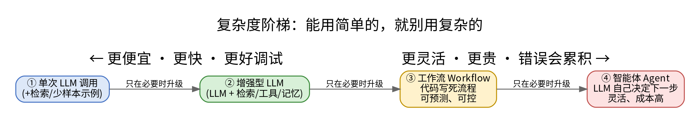

从左到右，系统越来越灵活，但也越来越贵、越慢、越难调试：

| 级别 | 是什么 | 典型例子 |
|---|---|---|
| ① 单次 LLM 调用 | 一个提示词，一次调用；可以加检索（RAG）和少样本示例 | 把一段 Valgrind 报告翻译成人话 |
| ② 增强型 LLM | LLM 能用检索、工具、记忆 | LLM 自己决定去调用“运行检测器”这个工具 |
| ③ 工作流 | **你写代码**把多次 LLM 调用和工具串起来，路径固定 | 先生成补丁→编译检查→再生成测试 |
| ④ 智能体 | **LLM 自己决定**下一步做什么、调用什么工具、何时结束 | 给它一个泄漏的程序，它自己查、自己改、自己验证 |

原文的核心建议：

- **很多应用根本不需要 Agent**，优化好单次调用（加检索 + 上下文示例）往往就够了。
- Agent 系统通常是**用延迟和成本换效果**，要想清楚这笔交易值不值。
- 需要更多复杂度时：任务定义清晰 → 用**工作流**（可预测、一致）；需要大规模的灵活性和模型自主决策 → 用**Agent**。

---

## 2. 什么是 Agent：工作流 vs 智能体

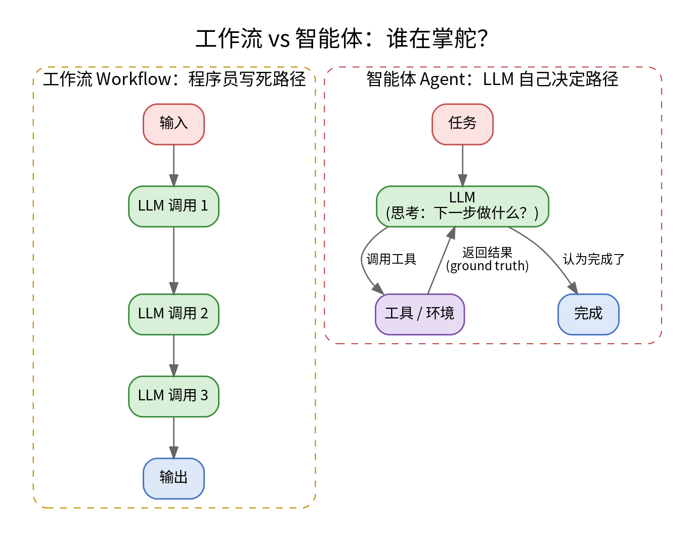

Anthropic 把所有这类系统统称为 **Agentic Systems（智能体式系统）**，但在架构上分成两类：

- **工作流（Workflows）**：LLM 和工具通过**预先定义好的代码路径**编排。
  - 方向盘在**程序员**手里。第几步调用什么，代码里写死了。
- **智能体（Agents）**：LLM **动态地主导自己的流程和工具使用**，自己掌控怎么完成任务。
  - 方向盘在 **LLM** 手里。它看到工具结果后，决定下一步干什么、什么时候算完成。

> 判断技巧：问自己“下一步做什么”是谁决定的？是 `if/else` 和 `for` 循环决定的 → 工作流；是模型的输出决定的 → Agent。

---

## 3. 要不要用框架？

原文提到的框架：Claude Agent SDK、AWS 的 Strands Agents SDK、Rivet（拖拽式 GUI）、Vellum（GUI 构建和测试工具）。国内常见的 LangChain / LangGraph / LlamaIndex / AutoGen / CrewAI 也属于这一类。

- **好处**：帮你处理调用 LLM、定义和解析工具、串联调用等底层琐事，上手快。
- **坏处**：多了一层抽象，**遮住了底层真实的 prompt 和 response**，难调试；还容易诱使你把系统搞得过于复杂。

原文建议：**先直接用 LLM 的 API**，很多模式几行代码就能实现（第 7 节你会看到一个 Agent 的核心就二三十行）。如果用框架，**一定要搞懂它底层在做什么**——“对底层的错误假设”是客户最常见的出错原因。

> 对你的建议：第一个原型直接用 API 手写。等你清楚自己要什么，再决定是否引入框架。

---

## 4. 基础构件：增强型 LLM（Augmented LLM）

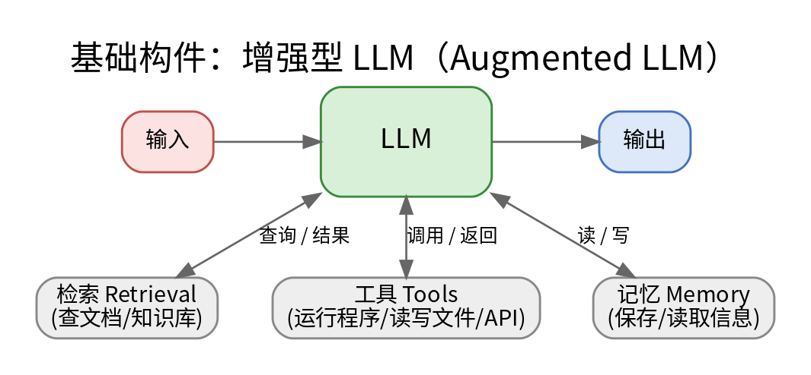

所有 Agentic 系统的**积木**，都是一个被增强过的 LLM，它具备三种能力：

| 增强能力 | 含义 | 在你项目里的例子 |
|---|---|---|
| 检索 Retrieval | 自己生成查询，去查文档/知识库 | 查“常见 C++ 内存泄漏模式”知识库 |
| 工具 Tools | 自己选择并调用外部函数 | `run_valgrind()`、`compile()`、`read_file()` |
| 记忆 Memory | 自己决定保留什么信息 | 记住“这个项目上次泄漏在 `cache.cpp`” |

实现时的两个重点：

1. **为你的具体场景定制**这些能力（不是工具越多越好）。
2. 给 LLM 提供**简单、文档清晰的接口**（第 10 节 ACI 会细讲）。

原文还提到 **MCP（Model Context Protocol，模型上下文协议）**：一种开放协议，让你用统一的客户端接入大量第三方工具。可以先知道它的存在，后面的课再深入。

**“工具调用”在 API 层面长什么样？**（以 Claude API 为例，其他厂商大同小异）

```python
resp = client.messages.create(
    model="claude-sonnet-4-5",
    max_tokens=1024,
    tools=[{
        "name": "run_leak_check",
        "description": "运行内存泄漏检测，返回增长量和可疑代码行",
        "input_schema": {"type": "object", "properties": {}},
    }],
    messages=[{"role": "user", "content": "app.py 好像有内存泄漏"}],
)
# 如果模型想用工具：resp.stop_reason == "tool_use"
# resp.content 里会有一个 {"type": "tool_use", "name": "run_leak_check", "id": "...", "input": {}}
# 注意：模型只是“说它想调用”，真正执行工具的是你的代码；执行完再把结果发回给模型。
```

> 关键认知：**LLM 自己不会执行任何东西**。它只输出“我想调用 X，参数是 Y”，你的程序负责执行并把结果回传。Agent 的一切能力都建立在这个机制之上。

---

## 5. 五种工作流模式

下面 5 种模式复杂度逐步上升。每种都按“是什么 → 什么时候用 → 原文例子 → 你的项目”来讲。

### 5.1 提示链（Prompt Chaining）

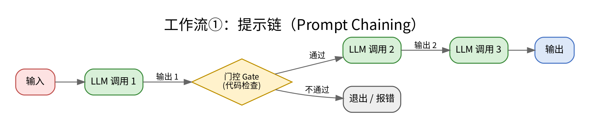

- **是什么**：把任务拆成**固定顺序**的几步，每次 LLM 调用处理上一步的输出。中间可以加**门控（Gate）**——用普通代码检查中间结果，不合格就提前退出。
- **什么时候用**：任务能被**干净地拆成固定子任务**。本质是**用延迟换准确率**：每次调用的任务更简单，所以更准。
- **原文例子**：先写营销文案，再翻译成另一种语言；先写文档大纲 → 检查大纲是否符合要求 → 再按大纲写正文。
- **你的项目**：注入阶段 = ①LLM 选择注入点 → ②LLM 生成泄漏补丁 → **门控**：能编译吗？检测器确实报泄漏吗？→ ③LLM 生成该泄漏的描述（作为标准答案）。

### 5.2 路由（Routing）

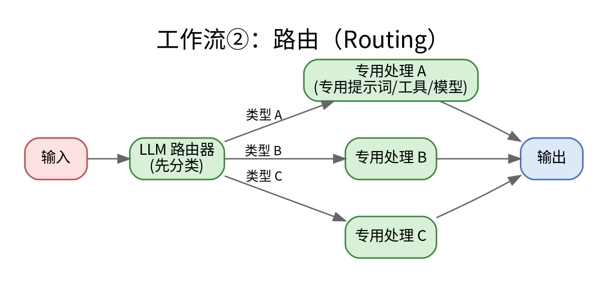

- **是什么**：先对输入**分类**，再交给对应的专门流程处理。实现了**关注点分离**，每个分支可以有专门的提示词、工具、甚至模型。
- **为什么需要**：如果一个提示词要兼顾所有输入类型，为某类输入优化往往会损害其他类型的表现。
- **什么时候用**：输入有**明显不同的类别**，且**分类本身能做得准**（用 LLM 或传统分类器都行）。
- **原文例子**：客服问题分成一般咨询 / 退款 / 技术支持，各走各的流程；简单问题交给小而便宜的模型（如 Claude Haiku），难题交给更强的模型（如 Claude Sonnet）。
- **你的项目**：按泄漏类型路由——“忘记 free/delete”、“循环引用”、“全局缓存无限增长”、“未关闭的文件句柄/连接”，每类配不同的修复提示词和检测工具。

### 5.3 并行（Parallelization）

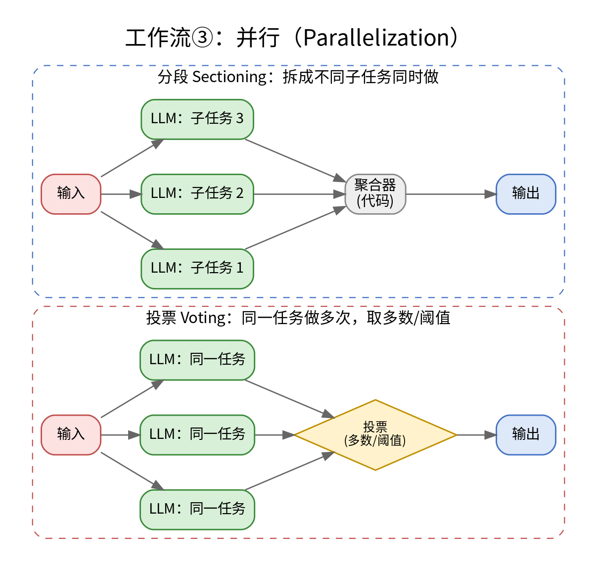

两种变体：

- **分段（Sectioning）**：把任务拆成**互相独立**的子任务，同时跑，最后用代码汇总。
- **投票（Voting）**：**同一个任务跑多次**（可用不同提示词），得到多样化结果后投票/设阈值。

- **什么时候用**：子任务可并行以**提速**；或需要**多个视角/多次尝试**来提高可信度。原文观察：复杂任务里，**每个考虑点用单独一次 LLM 调用**处理，通常比一次调用兼顾所有点效果更好。
- **原文例子**：
  - 分段：一个模型实例处理用户请求，另一个专门做内容安全审查（护栏）——比一次调用同时做两件事效果好；自动化评估时每次调用评估一个维度。
  - 投票：用几个不同提示词分别审查代码漏洞，任何一个发现问题就标记；判断内容是否不当，用多个提示词 + 不同投票阈值来平衡误报和漏报。
- **你的项目**：监测阶段并行跑 ASan、Valgrind、内存曲线监控（分段）；用 3 次独立 LLM 判断“这是不是真泄漏”，2 票以上才算（投票，降低误报）。

### 5.4 编排者-工作者（Orchestrator-Workers）

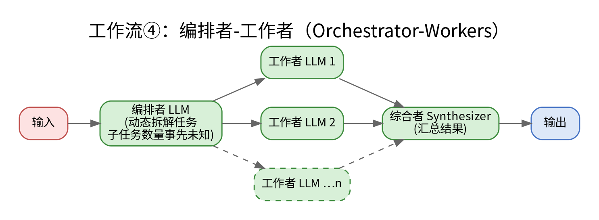

- **是什么**：一个中心 LLM（编排者）**动态拆解任务**，分派给多个工作者 LLM，再综合它们的结果。
- **和并行的区别**：图看起来像，但关键在于**子任务不是预先定义的**，而是编排者根据具体输入**临时决定**的。
- **什么时候用**：无法预知需要哪些子任务的复杂任务。比如写代码时，要改几个文件、每个文件怎么改，都取决于具体任务。
- **原文例子**：每次要改多个文件的编码产品；需要从多个来源收集和分析信息的搜索任务。
- **你的项目**：大型代码库里一个泄漏可能牵涉多个模块。编排者读检测报告后决定“需要分别检查 A、B、C 三个模块”，派三个工作者各自分析，再综合出修复方案。

### 5.5 评估者-优化者（Evaluator-Optimizer）

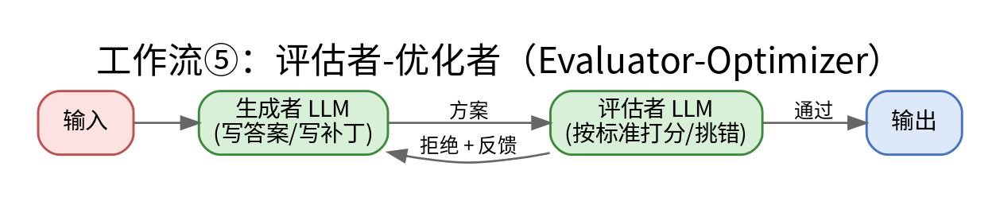

- **是什么**：一个 LLM 生成，另一个 LLM 评估并给反馈，**循环**直到通过。
- **什么时候用**：有**清晰的评估标准**，且迭代改进能带来**可衡量的价值**。两个适配信号：
  1. 人类给出反馈时，LLM 的回答能明显变好；
  2. LLM 自己也能给出这样的反馈。
  就像人类作者反复修改稿子。
- **原文例子**：文学翻译（评估者能指出译者没抓住的细微之处）；需要多轮搜索的复杂搜索任务（评估者决定是否还要继续搜）。
- **你的项目**：生成者写修复补丁 → 评估者检查“是否真的修了泄漏、有没有引入新 bug、代码风格是否合规” → 不通过就带着反馈重写。**更好的做法**是让评估者尽量依赖**客观信号**（检测器结果、测试结果），而不只是另一个 LLM 的主观意见。

---

## 6. 自主智能体（Autonomous Agents）

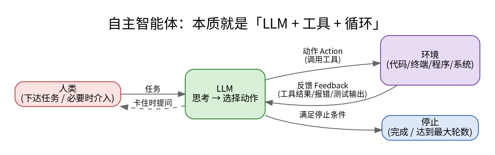

### 6.1 Agent 是怎么工作的

原文描述的流程：

1. 从人类的**指令**或**交互式讨论**开始；
2. 任务明确后，Agent **自主规划和执行**，必要时回来找人类要信息或判断；
3. 执行中，每一步都要从环境获取 **“地面真相”（ground truth）**——比如工具调用结果、代码执行结果——来评估进展；
4. 可以在**检查点**或**遇到阻碍时**暂停等人类反馈；
5. 任务完成时结束，但通常也会设置**停止条件**（如最大迭代次数）来保持可控。

> 原文金句：Agent 能处理复杂任务，但实现往往很简单——**它们通常只是在循环中、根据环境反馈使用工具的 LLM**。所以**工具集和工具文档的设计**至关重要。

### 6.2 什么时候用 Agent

- 适合：**开放式问题**，很难或不可能预测需要多少步，**无法写死固定路径**。LLM 可能运行很多轮，你必须对它的决策有一定信任。
- 代价：**成本更高**，且**错误会累积**（第 3 步错了，后面全错）。
- 必须：在**沙箱环境**中充分测试，并配备合适的**护栏（guardrails）**。

### 6.3 原文例子：编码 Agent

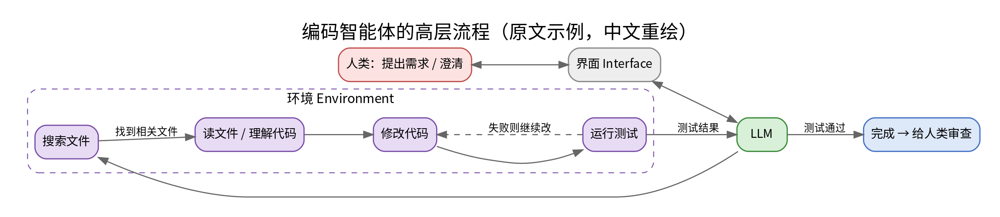

Anthropic 自己做过的 Agent：解决 SWE-bench 任务的编码 Agent（根据任务描述修改多个文件）；“computer use” 参考实现（Claude 操作电脑完成任务）。

---

## 7. 动手：二三十行代码的 Agent 循环

本文件夹的 `code/` 里有一个能跑的小例子：让 Agent 修复一个**故意带内存泄漏**的 Python 玩具程序。

| 文件 | 作用 |
|---|---|
| `code/leaky_app.py` | 带泄漏的玩具服务：每个请求 10KB 数据塞进全局列表，永不释放 |
| `code/check_leak.py` | 检测器：用 Python 自带的 `tracemalloc` 比较前后内存，输出 `LEAK` / `PASS` 和可疑代码行 |
| `code/mini_agent.py` | Agent 本体：3 个工具 + 循环 + 最大轮数；支持 Google AI Studio (Gemini)、Anthropic 和 `--mock` 假 LLM 模式 |

**运行（Windows 也可以，直接用 `python`）：**

```bash
cd code
python check_leak.py leaky_app.py   # 先自己看看检测器输出：结果: LEAK
python mini_agent.py --mock         # 不需要 API Key：用写好剧本的“假 LLM”演示整个循环
```

**用 Google AI Studio（Gemini API Key）跑真实模型（纯 Python 标准库，无需 `pip install`）：**

```powershell
# PowerShell：
$env:GEMINI_API_KEY="你的Google AI Studio Key"
python mini_agent.py
```

```cmd
:: CMD（命令提示符）：
set GEMINI_API_KEY=你的Google AI Studio Key
python mini_agent.py
```

- 默认模型为 `gemini-4-hydrogen`（支持免费层），也可以用 `--model` 或 `GEMINI_MODEL` 环境变量切换，例如：`python mini_agent.py --model gemini-3.8-flash`。
- 如需代理访问 Google API，请在终端设置 `HTTPS_PROXY` 环境变量。
- 如果改用 Anthropic（Claude），安装 `pip install anthropic` 后设置 `ANTHROPIC_API_KEY` 再运行 `python mini_agent.py --anthropic`。

Agent 每次都在 `code/workspace/` 里的副本上工作，原始的 `leaky_app.py` 不会被改。

**核心循环（`mini_agent.py` 中的 `agent_loop`），这就是 Agent 的全部骨架：**

```python
messages = [{"role": "user", "content": task}]
for turn in range(1, MAX_TURNS + 1):                  # 停止条件：最大轮数
    resp = client.messages.create(model=MODEL, system=SYSTEM,
                                  tools=TOOLS, messages=messages, max_tokens=4096)
    messages.append({"role": "assistant", "content": resp.content})
    if resp.stop_reason != "tool_use":                # 模型不再要工具 = 它认为完成了
        return
    results = []
    for block in resp.content:
        if block.type == "tool_use":
            out = run_tool(block.name, block.input)   # 你的代码执行工具（动作）
            results.append({"type": "tool_result",
                            "tool_use_id": block.id, "content": out})
    messages.append({"role": "user", "content": results})   # 环境反馈喂回模型
```

`--mock` 模式的输出（节选），你能清楚看到“思考 → 动作 → 反馈”的循环：

```text
[第1轮 LLM 说] 先跑检测器，拿到证据。
[第1轮 调用工具] run_leak_check {}
[工具返回] 内存增长: 19659.1 KB (阈值 977 KB)
   .../workspace/leaky_app.py:7: size=24.0 MiB (+19.2 MiB), count=5000 (+4000) ...
[第2轮 LLM 说] 增长集中在 leaky_app.py 的 bytearray 那行，读代码看看。
[第2轮 调用工具] read_file {"path": ".../workspace/leaky_app.py"}
[第3轮 LLM 说] _cache 是只增不减的全局列表，改成有上限的 deque。
[第3轮 调用工具] write_file {...}
[第4轮 LLM 说] 修好了，再检测一次确认。
[工具返回] 内存增长: 0.6 KB (阈值 977 KB) ... 结果: PASS
[第5轮 LLM 说] 检测结果 PASS：把无上限的全局列表 _cache 改成了 deque(maxlen=100)。
```

> 注意：mock 模式里“LLM 的决定”是写死的剧本，只用来让你看清数据如何流动；真实模式下，每一轮调用哪个工具完全由模型决定。
> 说明：`mini_agent.py` 内置了 `GeminiClient`（直接调用 Gemini `generateContent` REST API，不依赖第三方包），把 Gemini 的 `functionCall` / `functionResponse` 适配成和上面 `agent_loop` 一致的格式；只要设置了 `GEMINI_API_KEY` 就会自动使用。`--mock` 模式以及本地模拟 Gemini HTTP 接口的多轮工具调用均已实测通过（打包环境没有真实 Key，未直连线上接口）。若改用其他厂商（DeepSeek、通义千问等 OpenAI 兼容接口），工具调用的字段名不同（`tool_calls` / `role: "tool"`），思路完全一样。

**动手练习：**

1. 读 `mini_agent.py`，找到这三样东西：工具定义（`TOOLS`）、工具执行（`run_tool`）、循环（`agent_loop`）。
2. 把 `MAX_TURNS` 改成 2 再跑 `--mock`，观察停止条件如何生效。
3. 思考：如果 `run_leak_check` 把 10 万行原始日志全部返回给模型，会发生什么？（提示：看 `run_tool` 里的 `[-3000:]`。）

---

## 8. 组合与定制 + 三条核心原则

这些模式**不是死规定**，而是可以自由组合、按需改造的积木。成功的关键和所有 LLM 功能一样：**度量效果，持续迭代**。再强调一遍：**只有当复杂度能被证明改善结果时才增加它**。

实现 Agent 时遵循的**三条核心原则**：

1. **保持简单（Simplicity）**：Agent 的设计要简单。
2. **保持透明（Transparency）**：明确展示 Agent 的规划步骤（就像上面每轮打印“LLM 说了什么、调了什么工具”）。
3. **精心设计 ACI（Agent-Computer Interface）**：通过完善的工具**文档和测试**打磨 Agent 与计算机之间的接口。

框架能帮你快速起步，但走向生产时，**不要犹豫减少抽象层、用基础组件构建**。

---

## 9. 附录 1：Agent 在实践中的两个成功领域

Agent 最有价值的任务通常同时具备：**既要对话又要行动**、**有清晰的成功标准**、**能形成反馈循环**、**有有意义的人类监督**。

**A. 客服**：天然是对话流程，又需要查外部信息和执行动作（查订单、退款、更新工单），而且成功可以用“问题是否解决”清晰衡量。有公司甚至只按“成功解决”收费。

**B. 编码 Agent**，之所以特别有效，是因为：

- 代码方案可以通过**自动化测试验证**；
- Agent 可以**用测试结果作为反馈**迭代方案；
- 问题空间**定义清晰、结构化**；
- 输出质量可以**客观衡量**。

Anthropic 的实现能仅凭 PR 描述就解决 SWE-bench Verified 里的真实 GitHub issue。但原文也强调：自动化测试能验证功能，**人类审查仍然关键**，用来确保方案符合更大的系统要求。

> **对你的项目是个好消息**：内存泄漏修复几乎完美符合编码 Agent 的四个条件——泄漏检测器（ASan / Valgrind / LeakSanitizer / tracemalloc）就是天然的“自动化测试”，“泄漏字节数 = 0 且原有测试通过”就是客观的成功标准。

---

## 10. 附录 2：给工具做“提示工程”（ACI 设计）

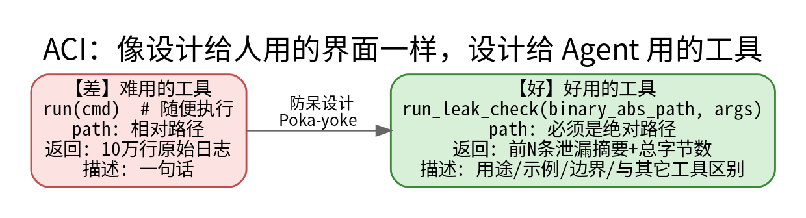

工具定义应该得到和整体提示词**同等的提示工程投入**。

### 10.1 选择对模型友好的格式

同一个动作可以有多种表达方式，例如修改文件可以“写 diff”或“重写整个文件”；结构化输出可以把代码放在 Markdown 里或 JSON 里。对人来说差别不大，但**对 LLM 难度差别很大**：

- 写 diff 需要在写新代码**之前**就知道 chunk 头里有多少行要改；
- 把代码放进 JSON 需要额外转义换行和引号。

建议：

1. 给模型足够的 token 去“思考”，别让它把自己写进死胡同；
2. 格式尽量接近模型在互联网文本中**自然见过**的样子；
3. 避免格式上的额外负担，比如要精确计数上千行代码，或对代码做字符串转义。

（这就是 `mini_agent.py` 里 `write_file` 选择“整体覆盖写入”而不是 diff 的原因。）

### 10.2 像设计 HCI 一样设计 ACI

人机界面（HCI）花多少心思，Agent-计算机界面（ACI）就该花多少心思：

- **站在模型的角度想**：只看描述和参数，能一眼看懂怎么用吗？如果你自己都要想半天，模型也会。好的工具定义通常包含：**用法示例、边界情况、输入格式要求、与其他工具的明确区别**。
- **改参数名和描述**让意思更明显——就像给团队里的初级工程师写一份好的 docstring。工具很多且相似时尤其重要。
- **测试模型怎么用你的工具**：跑大量示例输入，看模型犯什么错，然后迭代。
- **防呆设计（Poka-yoke）**：改造参数，让模型**更难犯错**。

原文真实案例：做 SWE-bench Agent 时，他们**花在优化工具上的时间比优化整体提示词还多**。例如模型在离开根目录后用相对路径会出错，于是把工具改成**必须使用绝对路径**，之后模型就再没用错过。（`mini_agent.py` 的 `_check_path` 就照搬了这个做法。）

---

## 11. 映射到你的项目：内存泄漏 注入 → 监测 → 修正

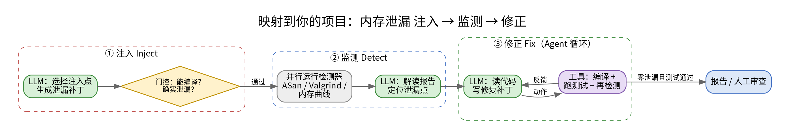

| 阶段 | 推荐模式 | 理由 |
|---|---|---|
| ① 注入 | **提示链 + 门控** | 步骤固定（选点→生成补丁→验证），用代码门控确保“能编译且真的泄漏” |
| ② 监测 | **并行（分段）** + 可选**路由** | 多个检测器同时跑；按泄漏类型路由到不同分析提示词 |
| ③ 修正 | **自主 Agent**（或先从**评估-优化**开始） | 要读多少文件、改几次无法预知；检测器 + 测试提供客观反馈 |
| 整体 | **工作流把三段串起来** | 平台级流程是固定的，只有“修正”这一段才真正需要 Agent 的自主性 |

**按原文精神的落地建议：**

1. **从最简单的开始**：先做“单次 LLM 调用：给它代码 + 检测报告，让它输出补丁”，建立评估集（比如 20 个已知泄漏样本），看成功率。
2. 成功率不够，再升级为**评估-优化**循环（用检测器结果作为评估者）。
3. 仍不够（比如跨文件的复杂泄漏），再升级为**自主 Agent**，并配上：沙箱（容器里编译运行）、最大轮数、修改前后都跑测试、最终人工审查。
4. **工具设计优先**：`run_leak_check` 返回的应该是“前 N 条泄漏摘要 + 调用栈 + 总字节数”，而不是几万行原始日志；路径一律绝对路径。

### 选型速查：决策树

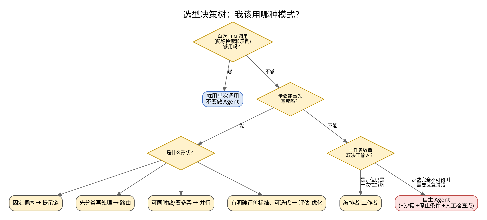

---

## 12. 术语表

| 中文 | 英文 | 一句话解释 |
|---|---|---|
| 智能体式系统 | Agentic System | 工作流和智能体的统称 |
| 工作流 | Workflow | 代码预先写死路径来编排 LLM 和工具 |
| 智能体 | Agent | LLM 自己动态决定流程和工具使用 |
| 增强型 LLM | Augmented LLM | 带检索、工具、记忆的 LLM，是一切的积木 |
| 工具调用 | Tool Use / Function Calling | 模型输出“想调用的函数和参数”，由程序执行 |
| 门控 | Gate | 工作流中间用代码做的检查点 |
| 地面真相 | Ground Truth | 来自环境的真实反馈（工具结果、测试结果） |
| 停止条件 | Stopping Condition | 例如最大轮数，防止 Agent 无限运行 |
| 护栏 | Guardrails | 限制 Agent 行为、防止有害输出或操作的机制 |
| 模型上下文协议 | MCP | 统一接入第三方工具的开放协议 |
| Agent-计算机界面 | ACI | 工具的定义、参数、文档——Agent 的“用户界面” |
| 防呆设计 | Poka-yoke | 通过设计让错误难以发生 |

---

## 13. 自测题

<details>
<summary>1. 一个系统：先用 LLM 分类 bug 类型，再按类型调用不同提示词修复。它是工作流还是 Agent？是哪种模式？</summary>

工作流，路由模式。“下一步做什么”由代码里的分支决定，LLM 只负责分类和处理，不决定流程。
</details>

<details>
<summary>2. “编排者-工作者”和“并行”图长得很像，本质区别是什么？</summary>

并行的子任务是**预先定义**的；编排者-工作者的子任务是编排者根据输入**动态决定**的（数量和内容都事先未知）。
</details>

<details>
<summary>3. 为什么原文不建议一开始就用框架？</summary>

框架增加抽象层，遮住底层的 prompt 和 response，难调试；还容易诱使你过度设计。很多模式直接用 API 几行代码就能实现。用框架也要懂底层。
</details>

<details>
<summary>4. Agent 的核心实现由哪几部分组成？</summary>

LLM + 工具 + 循环：调用模型 → 若模型请求工具则执行并把结果喂回 → 重复，直到模型不再请求工具或触发停止条件（如最大轮数）。
</details>

<details>
<summary>5. 为什么让 Agent 用“整体重写文件”比“写 diff”更可靠？</summary>

写 diff 需要提前精确知道要改动的行数（chunk 头），对模型格式负担大、易出错；整体重写更接近模型自然见过的文本格式。
</details>

<details>
<summary>6. 为什么内存泄漏修复很适合用 Agent？</summary>

它满足编码 Agent 的条件：有自动化验证（泄漏检测器 + 测试）、可用检测结果作为反馈迭代、问题定义清晰、结果可客观衡量（泄漏字节数）。
</details>

---

## 14. 下一步

本课讲的是“**为什么、什么时候、用哪种模式**”。下一课会进入阅读清单的第 2 项，继续往“怎么做”深入。

**课后作业（可选）：** 用自己的话，在纸上画出你的平台“修正”阶段的 Agent 循环：LLM 能用哪些工具？每个工具的输入输出是什么？停止条件是什么？什么时候必须让人类介入？
