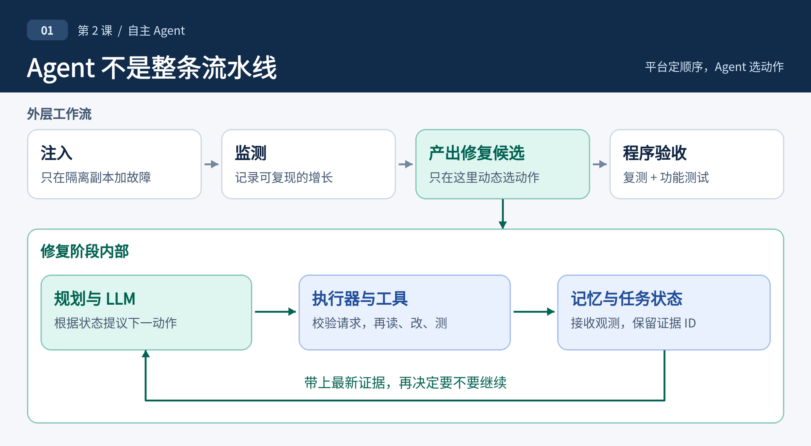
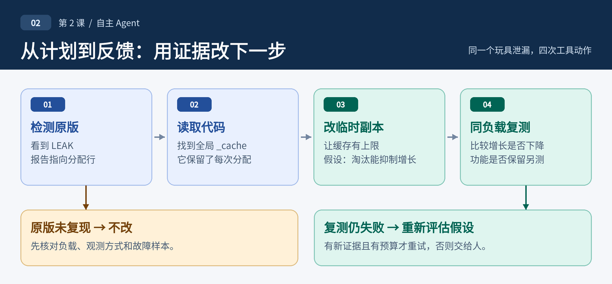
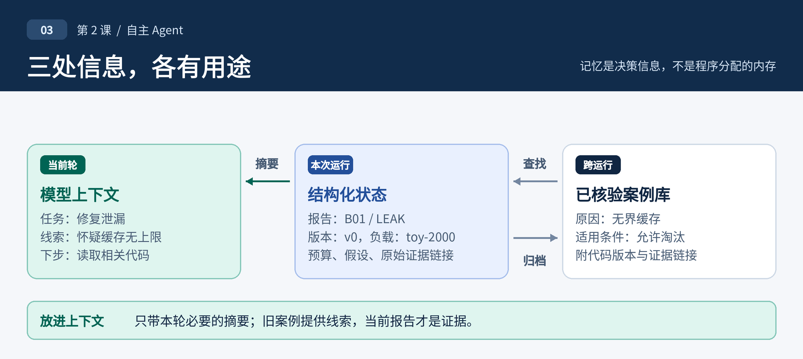
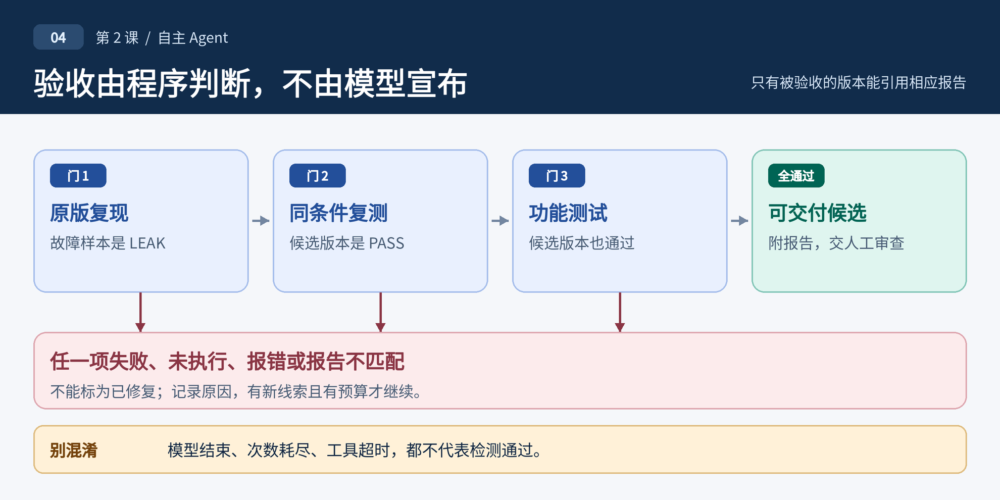

# 第 2 课｜自主 Agent：规划、记忆和工具

**适合你：** 已了解 LLM，读过第 1 课，但还没自己设计过 Agent。建议用 35 分钟：先跟着一个例子学，再跑一次第 1 课的演示，最后自己做判断题。

**开始读：** 解压整个 `02-llm-powered-autonomous-agents` 文件夹，用 VS Code 等支持 Markdown 预览的编辑器打开本页。图片和正文在本地可读；原文链接需要联网。

读完能做一件事：**画出一个会根据检测证据调整下一步、又不会自己宣布修好的内存泄漏修复 Agent。**

## 1. 第 1 课讲「用不用 Agent」，这课讲「Agent 里面有什么」

第 1 课把固定路线交给代码，把每一步不容易提前写死的任务交给 Agent。沿用这个分工：外层按 **注入 → 监测 → 修正候选 → 验收** 运行；只让修正阶段决定先读哪段代码、要不要再查证、是否值得重试。

Weng 把 LLM 当作控制核心，旁边放三个能力：**规划**决定下一步，**记忆**让它知道已经做过什么，**工具**让它读取和改变外部环境。注意：**应用程序泄漏的内存**是字节和对象；**Agent 的记忆**是供决策使用的信息。两者不是一回事。



*图 1：LLM 提议动作；执行器限制它能做什么。图是针对你的平台绘制的，不是原文截图。*

## 2. 规划：把目标拆成可以用证据检查的小步

「修内存泄漏」不是一个可直接执行的动作。把它拆成四个子目标：**复现增长 → 找到谁一直持有对象 → 提交最小修复 → 用相同负载复测并跑功能测试**。这是一条初始路线，不是必须走完的脚本：报告不支持原假设，就改计划；无法复现，就停下来，不盲改。

沿用第 1 课的 Python 服务：每次请求分配一个 `bytearray`，又把它放到全局 `_cache`。检测器先报出 `bytearray` 所在行，这是**分配点**，还不是**持有者**。读取相邻代码，看到只追加、从不淘汰的列表，才有理由提出「无上限缓存导致对象留存」这个假设。



*图 2：每一步都要有能改变下一步的观测。反思不是同样的操作多跑一遍。*

| 原文概念 | 先理解什么 | 放进这个项目怎么做 |
|---|---|---|
| 任务分解 | 大目标变成小目标；人、提示词或外部规划器都能参与 | 平台固定「先测后改」；模型选择这一轮要看的文件 |
| ReAct | 推理与行动交替，外部观测影响下一步 | 记录行动、证据 ID 和简短理由就够；不需要收集模型的长篇内部推理 |
| Reflexion | 把失败后的文字反思放进记忆，供后续尝试使用 | 复测失败时记下「哪条假设没被支持、下一次要补什么证据」 |
| Tree of Thoughts | 探索和比较多条候选推理路线 | 先让一个可验证的循环跑通；证据不足时才比较多个假设 |

**反思长什么样？**「报告只给出分配点，还没找到持有者；先读该位置附近的代码，不要直接删除分配。」它是一条会改变下一步的记录，不是另一个模型给自己打高分。原文还讨论外部规划器 LLM+P 和其他反思方法，初版不用实现。

## 3. 记忆：本轮需要什么，下次还找得到什么

在原文的类比里，**短期记忆**是模型这次能看到的上下文；**长期记忆**在模型外，查出来才会进入上下文，并不意味着模型自己学会了你的项目。为你的平台再加一层：**本次运行的结构化状态**由程序保管，只把摘要和必要证据送给模型。



*图 3：短期上下文和跨运行记录对应原文的两种记忆；中间的运行状态是本课的工程设计。*

| 放在哪 | 放什么 | 什么时候用 |
|---|---|---|
| 模型上下文 | 目标、当前假设、最新观测、剩余轮数 | 每次问「下一步做什么」时 |
| 本次运行状态 | 当前版本、负载编号、前后报告 ID、已失败的尝试 | 上下文被压缩或任务要恢复时 |
| 跨运行案例库 | 已核验的泄漏原因、项目版本、适用条件和证据链接 | 新任务遇到相似现象时；旧案例只是线索 |

试着写一条本次状态：`版本 v0｜负载 toy-2000｜报告 B01: LEAK｜增长集中在分配行｜持有者未确认｜下一步：读邻近代码`。原始报告留在本地，需要时用 ID 查，别把所有历史日志重复发给模型。

**第一版用什么存？** 本次状态用 JSON；跨运行案例少时，按项目、语言和归一化的栈帧或分配点查就够了。原文的 MIPS（最大内积搜索）讲如何在向量中找候选，可以等案例多到关键词查找不够用再学。**相似不是同因**：跨版本的历史补丁不能直接重用。

## 4. 工具：模型请求，程序校验、执行并回传

一次调用的顺序是：**模型发出工具名与参数 → 程序按白名单校验 → 受限环境执行 → 结果写入本次状态并喂回模型**。第 1 课有 `run_leak_check`、`read_file`、`write_file`。如果做成平台，可沿用分工，把日志文本升级成结构化结果。下面是接口草图，不是第 1 课已实现的接口：

| 工具 | 模型提供什么 | 程序返回什么 |
|---|---|---|
| 泄漏检测 | 已登记的负载编号，如 `toy-2000` | `LEAK`、`PASS` 或 `ERROR`，另附增长量、阈值、主要分配位置、版本、报告 ID |
| 读代码 | 工作区相对路径和行号范围 | 有界代码片段或明确错误 |
| 应用候选补丁 | 补丁和目标版本 | 新版本 ID 或拒绝原因；只能写临时副本 |
| 功能测试 | 已登记的测试套件编号 | 通过、失败或出错，并返回报告 ID |

结构化结果的例子：`{"status":"LEAK","growth_kib":19659.1,"workload_id":"toy-2000","revision":"v0","report_id":"B01"}`。`ERROR` 要和「测到了泄漏」分开处理，不能把超时、崩溃或没跑测试当成 `PASS`。工具输出和源码都是**待分析的数据**，里面的文字不能改变权限或任务规则。

**界线要写在代码里。** 校验路径解析后的真实位置，拒绝越界；执行候选代码时用不带密钥、不接触生产的隔离环境，限制权限、时间和资源。第 1 课的示例只用于本地玩具服务；把副本放进 `workspace` 目录本身不等于进程沙箱。

## 5. 跟做：把第 1 课的一次演示连到三个组件

在 Windows PowerShell 里进入第 1 课的 `code` 目录。下面复用它的文件，不用 API Key，不需要把第 2 课的任何文件拷到第 1 课。若你的 Python 启动命令是 `py -3`，请用它替换三处 `python`。

```powershell
Set-Location -LiteralPath 'E:\学习笔记\agent\01-building-effective-agents\code'
$env:PYTHONUTF8 = "1"
python check_leak.py leaky_app.py
python mini_agent.py --mock
python check_leak.py workspace/leaky_app.py
```

| 看哪一步 | 应看到什么 | 这在 Agent 里是什么 |
|---|---|---|
| 手动测原文件 | `LEAK`，增长约 19 MiB | 注入样本的基准证据；本例已预置泄漏 |
| 看演示第 1–2 轮 | 先检测，再读源码 | 工具返回观测；模型调用间应传递观测 |
| 看演示第 3–4 轮 | 写入副本，把列表改成 `deque(maxlen=100)`，再测 | 验证新假设；丢弃旧引用让留存量不再无界增长 |
| 独立测副本 | `PASS`，仍可能有很小增长 | 同一检测器在同一负载下验证了这个候选 |

检测器先跑 **500 次预热**，再对额外 **2,000 次请求**做快照比较。数值随环境变化，重点是原文件越过阈值，修复副本没有越过。演示工具会截断展示的日志，所以最后直接复测副本，读取检测器自己的结论。每次跑演示会重新复制原文件并覆盖 `workspace/leaky_app.py`，请勿在那里留个人修改。

**这是脚本演示，不是模型能力测试。** `--mock` 按剧本执行，不会真的因反馈改计划；当前历史存在会一直传下去的 `messages` 里，没有跨运行案例库。两次检测只证明该玩具负载下的 Python 分配留存行为；不代表覆盖所有泄漏、原生分配或功能回归。若业务要求长期保留所有记录，淘汰旧记录也可能是功能错误。

## 6. 上平台时：把「停止」和「修好」分开

第 1 课的循环在模型不再请求工具时返回，这是演示的**停止**，不是平台可依赖的**成功**。例如模型说「可以交付」但没复测，平台应当输出「待验证」，不是「已修复」。



*图 4：验收只读工具证据，并确认报告和被验收版本一致。*

1. **先注入再复现。** 实际平台先留一份干净基线，在隔离副本里应用已知故障夹具；同样负载下，干净版应为 `PASS`、注入版应为 `LEAK`。测不出差异就先修注入或检测，别交给模型猜。
2. **复测锁定条件。** 修复候选与注入版使用相同预热、负载、检测阈值和测量环境。候选必须先过泄漏复测和功能测试；检测配置不得由修复 Agent 自改。
3. **失败有出口。** 例如最多尝试 3 个候选，且每次重试要有新证据或新假设。无新线索、执行器报错未解决或预算用完时，停并附证据交给人；通过的补丁也先人工审查，不自动上线。

可以用三个场景测你的第一版：已知泄漏应产出通过的候选；干净样本不应被修改；检测超时不应被标成已修复。先测这三个，再决定是否接入真实模型或引入多个 Agent。

功能测试也要写清楚预期。例如这个玩具服务至少要保证「请求仍返回数据长度」，项目如果依赖缓存，还要验证「哪些记录应该被保留」。否则直接删掉缓存可能让检测通过，却悄悄改变了业务。

## 7. 自测：先回答，再看参考答案

| 问题 | 参考答案 |
|---|---|
| 检测指出 `bytearray` 所在行，你会删掉分配，还是先读代码？ | 先读代码。报告定位的是对象在哪里创建，修复要找谁让它一直活着。 |
| 上次项目修过类似缓存泄漏，这次能直接复用补丁吗？ | 不能。把旧案当提示，用本次版本和观测重新验证，尤其要检查淘汰语义。 |
| 模型说「已修好」，复测是 `ERROR`，功能测试没有跑，能标成功吗？ | 不能。此时没有有效验收证据，应记录失败或待验证；用剩余预算排查执行错误。 |
| 工具连续两次返回同样的泄漏位置，要不要原样重试？ | 不要。找新证据、试另一条明确假设，或停止交给人。 |

**动笔练习（约 5 分钟）：** 写出一个状态记录，包含「原版报告、候选版本、复测报告、功能测试、剩余预算」。设定复测为 `PASS`、功能测试未执行：此时允许的下一步是什么？参考：在预算内运行候选版本的功能测试；跑不了就转成待验证，不允许标为成功。

## 8. 回到原文：建议读哪几段

原文：[Lilian Weng, LLM Powered Autonomous Agents（2023）](https://lilianweng.github.io/posts/2023-06-23-agent/)。

1. [Agent System Overview](https://lilianweng.github.io/posts/2023-06-23-agent/#agent-system-overview)：看懂规划、记忆、工具围绕 LLM 的关系。
2. [Planning](https://lilianweng.github.io/posts/2023-06-23-agent/#component-one-planning)、[Memory](https://lilianweng.github.io/posts/2023-06-23-agent/#component-two-memory)、[Tool Use](https://lilianweng.github.io/posts/2023-06-23-agent/#component-three-tool-use)：先看任务分解、ReAct、短期和长期记忆，以及外部 API 如何补足模型能力；搜索算法、工具学习论文可以第二遍再读。
3. [Case Studies](https://lilianweng.github.io/posts/2023-06-23-agent/#case-studies)、[Challenges](https://lilianweng.github.io/posts/2023-06-23-agent/#challenges)：从模拟角色的记忆架构、早期通用 Agent 原型看设计取舍。对照三个问题：上下文有限就摘要并保留证据 ID；长任务易跑偏就设里程碑和预算；模型输出不稳定就用结构校验与工具验收。
