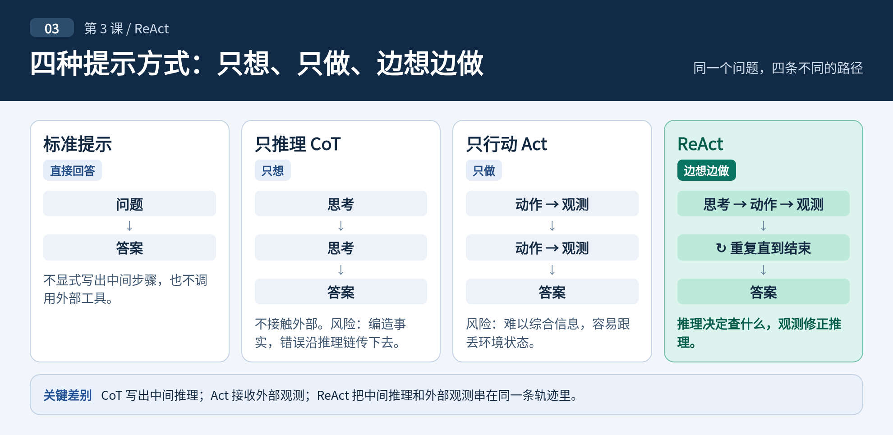
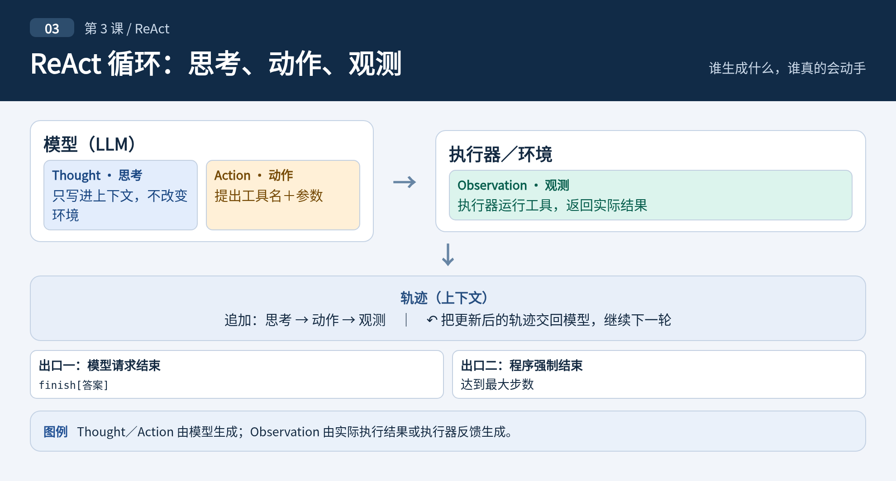
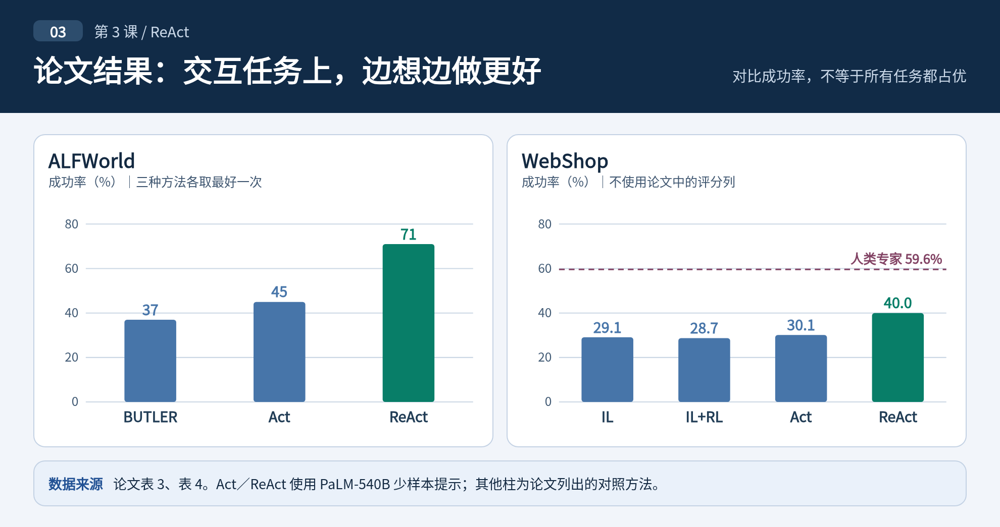
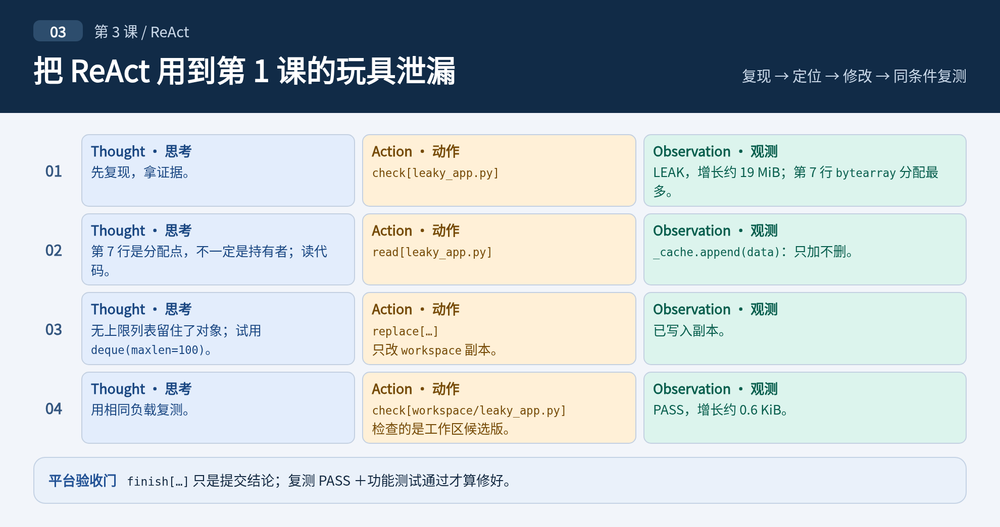
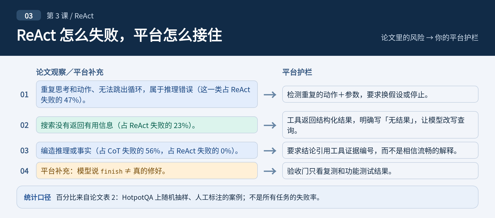

# 第 3 课｜ReAct：让模型边想边做

> 原文：Shunyu Yao 等，《ReAct: Synergizing Reasoning and Acting in Language Models》，ICLR 2023
> https://arxiv.org/abs/2210.03629
> 本笔记 = 论文要点的中文讲解 + 重绘的中文图 + 一个不需要 API Key 的文本版 ReAct 小程序 + 对你“内存泄漏 注入→监测→修正”平台的启示。
> 预计用时：阅读 35 分钟 + 动手 15 分钟。

**开始读：** 解压整个 `03-react-reasoning-and-acting` 文件夹，放在 `E:\学习笔记\agent\` 下，和第 1 课文件夹并列（第 5 节的程序要用第 1 课的 `code/`）。用 VS Code 等支持 Markdown 预览的编辑器打开本页。

---

## 0. 本课学完你应该能回答

1. ReAct 的 “Re” 和 “Act” 分别指什么？它和思维链（CoT）、纯工具调用有什么不同？
2. 一个 ReAct 轨迹里的 Thought、Action、Observation 各由谁产生？
3. 论文的实验说明了什么？哪些结论对你的项目最有用？
4. ReAct 最常见的失败方式是什么，平台该怎么接住？
5. 今天用函数调用（function calling）写 Agent，还需要 ReAct 吗？

**一句话总结全文：** 让模型**交替**输出“推理”和“动作”：推理决定下一步查什么、做什么，动作拿回的外部观测再修正推理。第 1 课 `mini_agent.py` 的循环，就是 ReAct 思想的现代写法。

---

## 1. 从第 1、2 课接上

- 第 1 课说：Agent 往往只是“**在循环中、根据环境反馈使用工具的 LLM**”，并给了一个二三十行的循环。
- 第 2 课在“规划”一节里把 ReAct 列为一种方法：推理与行动交替，外部观测影响下一步。
- 这一课回到 ReAct 的原始论文，看清楚这个循环**为什么**要把“想”和“做”交替起来，以及它在实验里**哪里强、哪里会翻车**。

---

## 2. 问题：只想不做，或只做不想



*图 1：论文图 1 的思路，用中文重画。不是原文截图。*

论文比较了四种提示方式（都是同一个冻结的大模型 PaLM-540B，只改提示词里的少样本示例）：

| 方式 | 模型输出什么 | 典型问题 |
|---|---|---|
| 标准提示（Standard） | 直接给答案 | 复杂问题答不对 |
| 只推理（CoT，思维链） | 一串思考，再给答案 | 只用模型自己记住的知识，**会编造事实**，一步错步步错 |
| 只行动（Act） | 一串工具动作，再给答案 | 能查到资料，但**不会综合**信息，在长任务里**跟丢状态** |
| **ReAct（推理 + 行动）** | 思考、动作、观测交替出现 | 推理决定查什么（reason to act），观测修正推理（act to reason） |

论文里的例子很直观：在文字游戏 ALFWorld 里，只行动的 Agent 看不出“水槽里没有胡椒瓶”，就一直重复无效动作；加上一句“胡椒瓶可能在柜子或抽屉里，先找柜子 1”这样的思考，它就能拆解目标、记住进度。

> 对你的项目：只看代码就“想”出修复（CoT），容易编一个看似合理的原因；只会反复跑检测器（Act），又得不出“谁持有了对象”。要两者交替。

---

## 3. ReAct 的核心：给动作空间加上“语言”



*图 2：Thought 和 Action 由模型生成，Observation 由环境（工具）生成；三者都追加进轨迹，作为下一步的上下文。*

论文的形式化只有一句话：Agent 原本在每一步从动作集合 A 里选一个动作；ReAct 把动作空间扩成 **A ∪ L**，L 是“自然语言”。

- **Thought（思考）** 是 L 里的“动作”：它**不改变环境**，也就**没有观测**；它只是把有用的推理写进上下文，供后面的步骤使用。
- **Action（动作）** 是 A 里的真实动作，例如 `search[实体]`，会改变环境或拿回信息。
- **Observation（观测）** 是环境返回的结果，由你的程序写回轨迹，**不是模型写的**。

论文总结了几类有用的思考：

| 思考的用途 | 例子（换成你的场景） |
|---|---|
| 分解目标、制定计划 | “先复现泄漏，再找持有者，最后复测” |
| 从观测中提取要点 | “报告里增长最多的是第 7 行的 `bytearray`” |
| 补充常识 | “分配点不等于持有者，要看谁一直引用它” |
| 跟踪进度 | “已经确认泄漏，下一步读代码” |
| 处理异常、调整计划 | “复测仍是 LEAK，原假设不成立，换一个” |

**两种节奏：**

- 推理为主的任务（问答、事实核查）：**稠密思考**，每一步都是 Thought → Action → Observation。
- 动作很多的决策任务（ALFWorld 游戏、WebShop 购物网站）：**稀疏思考**，由模型自己决定什么时候需要想一下。

**论文给模型的工具（问答任务）** 很简陋，只有三个，模拟人用维基百科：

| 动作 | 作用 |
|---|---|
| `search[实体]` | 返回该维基页面的前 5 句；不存在就返回最相近的 5 个页面名 |
| `lookup[字符串]` | 在当前页面里找下一句包含该字符串的句子（相当于 Ctrl+F） |
| `finish[答案]` | 结束任务并给出答案 |

论文作者特意说明，这个检索比当时最好的检索器弱很多，目的是**逼模型通过显式推理去检索**。

**提示词怎么写：** 从训练集里挑几个题（HotpotQA 6 个、FEVER 3 个），人工写出完整的 Thought/Action/Observation 轨迹作为少样本示例。人写示例时，只是在自己做的动作上方用语言写下当时的想法，不需要特别设计格式。

---

## 4. 实验结果：哪里强，哪里弱

### 4.1 知识问答与事实核查（HotpotQA、FEVER）

| 方法 | HotpotQA（精确匹配 %） | FEVER（准确率 %） |
|---|---|---|
| 标准提示 | 28.7 | 57.1 |
| CoT | 29.4 | 56.3 |
| CoT-SC（采样 21 条思维链投票） | 33.4 | 60.4 |
| Act | 25.7 | 58.9 |
| **ReAct** | 27.4 | **60.9** |
| CoT-SC → ReAct | 34.2 | **64.6** |
| ReAct → CoT-SC | **35.1** | 62.0 |

*数据来自论文表 1，PaLM-540B 少样本提示。*

怎么读这张表：

- **ReAct 在两个任务上都比 Act 好**：推理确实能帮助行动，尤其是最后综合出答案。
- **ReAct 和 CoT 互有胜负**：FEVER 上 ReAct 更好（60.9 对 56.3），因为核查事实需要查到准确的资料；HotpotQA 上略差（27.4 对 29.4）。
- **两者结合最好**：ReAct 在规定步数内（HotpotQA 7 步、FEVER 5 步）没给出答案，就退回 CoT-SC；或者 CoT-SC 的多数答案不到一半票数（说明模型自己没把握），就改用 ReAct。用内部知识 + 外部知识，效果最好。

论文还对 HotpotQA 抽样做了人工错误分析（表 2）：

| 类型 | ReAct | CoT |
|---|---|---|
| 成功中，推理或事实是编的（假阳性） | 6% | 14% |
| 失败中，推理错误（含反复重复上一步） | 47% | 16% |
| 失败中，搜索结果为空或没用 | 23% | — |
| 失败中，编造事实 | 0% | 56% |

结论：**CoT 的主要毛病是编造；ReAct 更“有据可查”，但更容易在推理上卡住**，特别是重复同样的思考和动作跳不出来，以及搜索没拿到有用信息后很难恢复。

### 4.2 交互式决策（ALFWorld、WebShop）



*图 3：ReAct 只用 1～2 个示例的提示，就超过了用上千到上万条数据训练的模仿学习 / 强化学习方法。*

- ALFWorld：ReAct 最好的一次成功率 71%，Act 最好的一次 45%，模仿学习方法 BUTLER 37%。
- WebShop：ReAct 成功率 40.0%，比之前最好的方法高约 10 个百分点，但离人类专家（59.6%）还很远。
- 论文还做了对照：把思考换成只复述环境状态的“内心独白”式提示（ReAct-IM），成功率从 71% 掉到 53%。**有用的是高层的目标分解和常识推理，不是把环境再念一遍。**

### 4.3 其他值得知道的

- **可解释、可干预**：人能分清哪些信息来自模型自己、哪些来自外部；论文演示了人工改掉一两句错误的思考，Agent 就能走回正轨。
- **微调**：用 ReAct 生成的 3,000 条正确轨迹微调小模型（PaLM-8B/62B），ReAct 成为四种方法里最好的。说明这种轨迹本身就是好的训练数据。
- **局限**：只靠提示词，模型能学到的推理和行动方式有限；复杂任务需要的示例多，又受提示词长度限制。这也是论文去尝试微调的原因。

---

## 5. 动手：跑一个“文本版”ReAct

本文件夹的 `code/react_text_agent.py` 按论文的格式工作：模型输出纯文本的 `Thought: ...` 和 `Action: 工具[参数]`，程序用正则解析动作、执行，再把 `Observation: ...` 追加到轨迹里。它复用第 1 课的 `leaky_app.py` 和 `check_leak.py`，只在本课 `code/workspace/` 的副本上修改，不碰第 1 课的文件。

| 动作 | 作用 |
|---|---|
| `check[文件]` | 用第 1 课的检测器检测 workspace 里的文件 |
| `read[文件]` | 读 workspace 里的文件 |
| `replace[旧文本 \|\|\| 新文本]` | 在副本里做一次精确替换 |
| `finish[总结]` | 模型认为完成了 |

**运行（Windows PowerShell）：**

```powershell
Set-Location -LiteralPath 'E:\学习笔记\agent\03-react-reasoning-and-acting\code'
$env:PYTHONUTF8 = "1"
python react_text_agent.py              # 剧本化的“假 LLM”，不需要 API Key
python react_text_agent.py --mock-loop  # 故意重复动作，看护栏怎么拦
```

如果第 1 课不在同级目录，加 `--lesson1 '第1课code目录的路径'`。



*图 4：轨迹的每一行都是一次 Thought → Action → Observation。*

正常模式的输出（节选）：

```text
[第1步] Thought: 先复现，拿到分配证据。
Action: check[leaky_app.py]
Observation: 内存增长: 19659.1 KB (阈值 977 KB)
   .../workspace/leaky_app.py:7: size=24.0 MiB (+19.2 MiB), count=5000 (+4000) ...
结果: LEAK

[第2步] Thought: 第 7 行是分配点，不一定是持有者，读代码。
Action: read[leaky_app.py]
Observation: ...  _cache.append(data)       # BUG：放进全局列表后永远不释放 ...

[第3步] Thought: 无上限全局列表留住了对象，试用有界队列。
Action: replace[_cache = [] ||| from collections import deque

_cache = deque(maxlen=100)]
Observation: 已写入工作区副本。

[第4步] Thought: 用相同负载复测候选版。
Action: check[workspace/leaky_app.py]
Observation: 内存增长: 0.6 KB (阈值 977 KB) ... 结果: PASS

[第5步] Thought: 复测未发现持续增长，提交结论。
Action: finish[已将无上限列表改为有界队列，复测 PASS。]
Observation: 已收到总结；由程序单独复测。
平台验收：PASS
```

`--mock-loop` 模式的输出（节选）：

```text
[第1步] Thought: 先读代码。
Action: read[leaky_app.py]
Observation: （文件内容）

[第2步] Thought: 再读一次同一个文件。
Action: read[leaky_app.py]
Observation: 重复动作，换一个假设或 finish

[第3步] Thought: 继续检查。
Action: check[leaky_app.py]
Observation: ... 结果: LEAK

[第4步] Thought: 回去读原来的代码。
Action: read[leaky_app.py]
...（read 和 check 交替，直到第 8 步）

达到最大步数（8）；未验收。
```

看第 2 步：连续两次完全相同的动作被拦下，没有执行。但第 3 步以后 `read` 和 `check` 交替出现，每一步都和上一步不同，护栏就拦不住了，最后只能靠**最大步数**停下，而且程序明确报告“未验收”，不会因为模型说过什么就算成功。这正是论文说的“跳不出循环”，也说明只比较相邻两步的护栏不够（见练习 4）。

**和第 1 课的 `mini_agent.py` 对比一下：**

| | 第 1 课 `mini_agent.py` | 本课 `react_text_agent.py` |
|---|---|---|
| 动作格式 | API 的结构化工具调用（`tool_use`） | 文本 `Action: 工具[参数]`，程序用正则解析 |
| 思考在哪 | 模型在工具调用前说的话 | 明确的 `Thought:` 行 |
| 怎么防止模型替环境说话 | API 天然分开 | 生成到 `Observation:` 就截停（stop 序列），观测只能由程序写 |
| 何时结束 | 模型不再调用工具 | 模型输出 `finish[...]`，或达到最大步数 |

> 注意：和第 1 课一样，`--mock` 里“模型的决定”是写死的剧本，用来看清数据怎么流动，不代表模型能力。`--llm openai` 选项按 OpenAI 兼容接口编写（DeepSeek、通义千问等可用），本笔记作者没有实际跑过，仅供参考。

**动手练习：**

1. 在代码里找到三样东西：提示词里的少样本示例、解析 `Action:` 的正则、把 `Observation:` 追加到轨迹的那一行。
2. 把 `MAX_STEPS` 改成 3 再跑，观察“没 finish 就到上限”时程序怎么报告。
3. 在剧本里把第 3 步的 `replace` 旧文本故意写错一个字，看 Observation 返回什么，想想真实模型拿到这个观测后应该怎么想。
4. 改进重复护栏：记下最近几步所有的“动作 + 参数”，同一个组合出现第二次就拦，再跑 `--mock-loop` 看看它是不是更早停下。

---

## 6. 今天还需要 ReAct 吗？

需要，只是换了写法：

- **函数调用（function calling）取代了文本解析。** 现在主流模型的 API 直接返回结构化的工具名和参数，不必自己写正则。第 1 课的循环就是这样。
- **思考不一定要单独一行。** 很多模型在调用工具前会先说一两句理由，或者有内置的“思考”能力。对你的平台来说，第 2 课的建议依然成立：**记录动作、证据 ID 和简短理由就够了**，不需要收集长篇推理。
- **不变的是思想：** 每次只走一步；每一步的依据来自真实观测；观测由环境给，不由模型说；有最大步数和结束条件。

---

## 7. 对你的平台：把论文的失败模式变成护栏



*图 5：左边是论文观察到的问题，右边是你的修复 Agent 该加的保护。*

| 论文观察 | 在泄漏修复里长什么样 | 护栏 |
|---|---|---|
| 重复上一步，跳不出循环 | 一直跑同一个检测、读同一个文件 | 检测重复的“动作 + 参数”，要求换假设或停止 |
| 搜索没返回有用信息，难以恢复 | 检测超时、报告为空、栈帧被截断 | 工具返回结构化结果，`ERROR` 和“无结果”写清楚，并提示可以换什么参数 |
| CoT 编造事实 | 没看报告就“推理”出泄漏原因 | 结论必须引用工具返回的报告 ID |
| `finish` 只是模型的说法 | 模型说“修好了”但没复测 | 平台验收门：同负载复测 PASS + 功能测试通过，才算修好 |
| 内部知识 + 外部知识结合最好 | 模型对常见泄漏模式有经验 | 允许模型先给假设，但必须用检测器验证；ReAct 步数用完就转人工 |
| 少样本示例决定行为 | 示例里怎么查，模型就怎么查 | 用 1～2 条**真实、正确**的修复轨迹做示例，后续也可以用成功轨迹做评估集或微调数据 |

**一个最小的修正阶段提示词骨架：**

```text
你是内存泄漏修复助手。每一步先写一句 Thought，再写一个 Action。
可用动作：check[负载编号]、read[文件:起始行-结束行]、patch[补丁]、finish[总结+证据ID]
规则：
- 先复现，再修改；没有 LEAK 证据就 finish 并说明“未复现”。
- 检测报告指向分配点时，先读代码找持有者，不要直接删分配。
- 同一个动作不要重复；复测失败要写出哪条假设没被支持。
- finish 里必须列出原版报告 ID 和复测报告 ID。
（下面放 1～2 条完整的示例轨迹）
```

---

## 8. 术语表

| 中文 | 英文 | 一句话解释 |
|---|---|---|
| 推理 + 行动 | ReAct (Reason + Act) | 交替生成思考和动作的提示范式 |
| 思维链 | Chain-of-Thought (CoT) | 先写推理步骤再给答案，只用模型内部知识 |
| 自洽采样 | CoT-SC (Self-Consistency) | 采样多条思维链，取多数答案 |
| 思考 | Thought / Reasoning trace | 不影响环境、只更新上下文的“语言动作” |
| 观测 | Observation | 环境对动作的返回，由程序写入 |
| 轨迹 | Trajectory | 问题 + 所有 Thought/Action/Observation 的序列 |
| 稠密 / 稀疏思考 | Dense / Sparse thoughts | 每步都想 / 由模型决定何时想 |
| 少样本提示 | Few-shot prompting | 在提示词里放几个完整示例 |
| 停止序列 | Stop sequence | 生成到某个字符串就停，防止模型替环境写观测 |
| 幻觉 | Hallucination | 编造不存在的事实 |

---

## 9. 自测题

<details>
<summary>1. Thought 为什么不会产生 Observation？</summary>

Thought 是语言空间里的“动作”，它不改变外部环境，只是把推理写进上下文。只有真实的 Action 才会让环境返回观测。
</details>

<details>
<summary>2. 为什么 ReAct 在 FEVER 上比 CoT 好，在 HotpotQA 上却略差？</summary>

FEVER 的“支持/反驳”往往差在细节上，必须查到准确资料，外部检索很关键。HotpotQA 需要灵活地组织多跳推理，ReAct “每步都要动作”的结构限制了推理的灵活性，加上搜索没结果时容易卡住，所以略差。两者结合最好。
</details>

<details>
<summary>3. 文本版 ReAct 里，为什么要在 “Observation:” 处截停生成？</summary>

否则模型会顺着格式自己编一个观测（比如自己写“结果: PASS”），然后基于假观测继续推理。观测必须来自真实执行。
</details>

<details>
<summary>4. 你的修复 Agent 连续三次 read 同一个文件，平台应该怎么做？</summary>

识别为重复动作，不再执行；返回观测提示“已读过，请提出新假设或调用其他工具”；如果仍然重复或预算用完，就停止并把已有证据交给人。
</details>

<details>
<summary>5. 模型输出 finish[已修复]，平台可以直接标记“修复成功”吗？</summary>

不可以。finish 只是停止信号。平台要自己用相同负载复测，并跑功能测试，两者都通过才算修复成功（第 2 课的验收门）。
</details>

---

## 10. 回到原文：建议读哪几段

原文：[ReAct（arXiv 2210.03629）](https://arxiv.org/abs/2210.03629)，项目主页 [react-lm.github.io](https://react-lm.github.io/)。

1. **第 1 节和图 1**：四种提示方式的对比，先把图看懂。
2. **第 2 节**：ReAct 的定义，一页左右，重点看“动作空间加上语言”和稠密/稀疏思考。
3. **第 3.3 节和表 2**：ReAct 与 CoT 的错误分析，对设计护栏最有用。
4. **第 4 节**：ALFWorld 和 WebShop 的结果，以及与 ReAct-IM 的对比。
5. **附录 C**：完整的提示词示例，自己写少样本示例时照着看。

