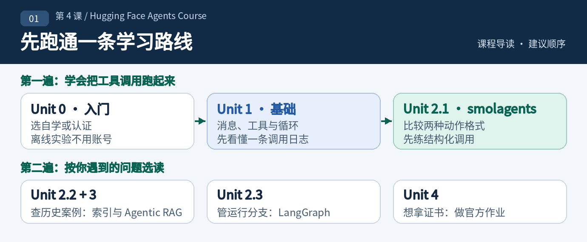
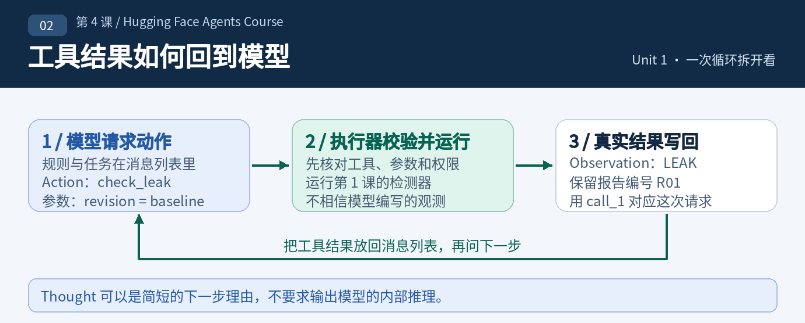
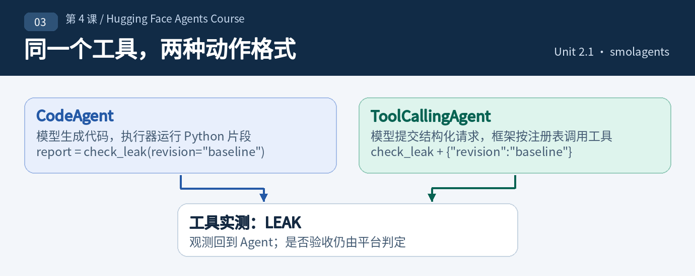
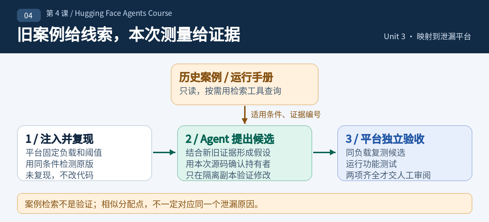

# 第 4 课｜Hugging Face Agents Course：从手写循环到框架

> 原课：[Hugging Face Agents Course](https://huggingface.co/learn/agents-course)。这份中文导读是你阅读清单的第 4 课，**不是**原课的 Unit 4。它带你选读原课、跑一遍离线实验，再把框架知识接到自己的内存泄漏平台上。预计阅读 35 分钟，动手 20 分钟；原课的 Notebook 和结课作业另计。

**开始读：** 把整个 `04-hf-agents-course` 文件夹解压到 `E:\学习笔记\agent\`，与 `01-building-effective-agents` 并列。用 VS Code 打开 `README.md`，按 `Ctrl+Shift+V` 预览；不要只复制 Markdown，图在同目录的 `images/`。动手部分需要第 1 课的 `code/`；不需要第 3 课的工作区，也不改动前几课。

## 0. 先把前三课接起来

- 第 1 课的 `mini_agent.py` 已经演示过 API 式工具调用。它是你认识框架内部循环的参照。
- 第 2 课把模型上下文、运行状态和历史案例库分开。本课分别把它们放进消息、工作流状态和检索工具。
- 第 3 课的 `react_text_agent.py` 从 `Action: check[leaky_app.py]` 这样的文本里提取动作。本课保留同一个泄漏问题，换成**结构化请求**，对照框架如何处理动作和工具结果。

**学完能做什么？** 你应该能指出一次工具调用中模型和程序各自负责的部分，选择适合当前阶段的框架，并画出一条不会把「Agent 说修好了」当成「程序已验收」的流程。

## 1. 原课怎么读最快



| 原课 | 第一遍怎么读 | 对平台有什么用 |
|---|---|---|
| [Unit 0：入门与学习路线](https://huggingface.co/learn/agents-course/unit0/introduction) | 先选自学或认证。做本课离线实验不用注册；跑原课在线示例时再看账号和模型设置。 | 先建立一个可复现的本地基线，不让联机配置阻塞学习。 |
| [Unit 1：Agent 基础](https://huggingface.co/learn/agents-course/unit1/introduction) | 重点看消息、工具、循环，再对照 [Dummy Agent Library](https://huggingface.co/learn/agents-course/unit1/dummy-agent-library) 和 [首个 Agent 教程](https://huggingface.co/learn/agents-course/unit1/tutorial)。 | 能读懂工具请求和观测日志，定位错误出在哪一层。 |
| Unit 2：框架 | 先看 [2.1 smolagents](https://huggingface.co/learn/agents-course/unit2/smolagents/introduction) 的两种 Agent；[2.2 LlamaIndex](https://huggingface.co/learn/agents-course/unit2/llama-index/introduction) 和 [2.3 LangGraph](https://huggingface.co/learn/agents-course/unit2/langgraph/introduction) 先看取舍，不必都安装。 | smolagents 练工具循环；LlamaIndex 练案例库；LangGraph 练状态、分支和固定验收。 |
| [Unit 3：Agentic RAG](https://huggingface.co/learn/agents-course/unit3/agentic-rag/introduction) | 看 Alfred 怎样在不同工具之间选择，再做 §5 的案例检索练习。 | 让 Agent 按需读历史报告和手册，不拿旧案代替本次采样。 |
| [Unit 4：结课作业](https://huggingface.co/learn/agents-course/unit4/introduction) | 想拿证书再跑官方作业；想做平台，先抄它「评价规则在 Agent 之外」的思路。 | 用固定样本和判分标准比较改动前后的表现。 |

## 2. Unit 1：一条工具结果怎样回到模型手里？

Agent 是能用模型推理、借助工具在环境里行动以达成目标的系统。让模型只解释 `tracemalloc` 是问答；让它根据测量结果选择先读哪一段代码、要不要提出候选，才把一部分决策交给了 Agent。不过，注入时机、测量条件和验收规则仍应由平台确定。



**Thought → Action → Observation：** Thought 是「测量超阈值，下一步找持有者」这样的简短决策说明；Action 是请求 `read_source`；Observation 是执行器实际读到的代码或返回的错误。模型收到新消息后才进入下一轮。并非每个 API 都会给你可见的 Thought；平台记录工具名、参数、结果、证据 ID 和必要的简短理由即可，不要求模型公开内部推理。

**消息不是模型的原生输入格式。** 程序用 `system` 表示规则、`user` 表示任务、`assistant` 表示模型的回复（可能有工具请求）、`tool` 表示工具结果（具体表示由 API 或框架确定）。聊天模板（chat template）负责把带角色的消息排成特定模型训练时见过的序列，例如用特殊 token 标记角色和轮次。用托管聊天 API 时通常直接传消息列表，由服务端处理格式；直接用 Transformers 跑聊天模型时，用对应 tokenizer 的 `apply_chat_template`，不要从另一款模型复制标记。详见原课 [消息与特殊 token](https://huggingface.co/learn/agents-course/unit1/messages-and-special-tokens)。

来看一次工具调用。下例只展示关键字段，不是可直接提交给所有 API 的请求体。`call_1` 让执行器能把结果对回正确的请求：

```text
assistant → tool_calls: [{"id":"call_1","name":"check_leak","arguments":{"revision":"baseline"}}]
tool      → tool_call_id: "call_1", content: {"status":"LEAK", "report_id":"R01", ...}
assistant → tool_calls: [{"id":"call_2","name":"read_source","arguments":{}}]
```

注册工具时，至少给模型**名称、用途、参数类型与含义**，给执行器**允许的值和失败处理方式**。例如 `check_leak(revision)` 只接受 `baseline` 或 `candidate`；不知道这个版本就返回明确错误，不能让模型传任意路径或命令。收到 JSON 也不等于授权：工具名、参数、当前状态仍要由程序校验。工具响应、源码和检索结果都是数据，里面的文字不能改权限。原课可接着看 [Tools](https://huggingface.co/learn/agents-course/unit1/tools) 和 [循环](https://huggingface.co/learn/agents-course/unit1/agent-steps-and-structure)。

## 3. Unit 2：框架替你做什么，哪些还要自己写？



| smolagents 类型 | 模型的动作 | 什么时候选 |
|---|---|---|
| [ToolCallingAgent](https://huggingface.co/learn/agents-course/unit2/smolagents/tool_calling_agents) | 结构化工具名与参数，例如 `check_leak` + `{"revision":"baseline"}`。框架解析后调用已注册的工具。 | 工具少，参数能列清，想逐次校验和记录。你的第一个平台原型先选它。 |
| [CodeAgent](https://huggingface.co/learn/agents-course/unit2/smolagents/code_agents) | 生成 Python 片段，例如 `report = check_leak(revision="baseline")`；执行器运行片段并记录观测。 | 一轮里要用变量、循环或组合多个工具时表达力更强，但模型生成的代码需要更严格的执行隔离。先在独立玩具环境体验，别用它直接读写真实项目。 |

两者都实现多步循环；区别在于**动作的表示和执行方式**，不是一个能用工具、另一个不能。框架能帮你处理动作解析、工具注册、观测回传和步数限制，但不会替你定义「泄漏」的测量口径、决定候选能改哪里或保证修复正确。尤其是 CodeAgent，允许导入的模块有限或代码放进一个目录，都不等于进程级安全隔离。

**想亲手跑框架？** 做完下节离线实验，再回到官方 [ToolCallingAgent 示例](https://huggingface.co/learn/agents-course/unit2/smolagents/tool_calling_agents) 跑一遍原课的搜索 Agent，对照 `tools=[...]`、`model=...` 和 `agent.run(...)` 各负责什么。在线模型的账号权限、可用模型和配额以官方页面为准；先用公开的示例数据，不把自己的代码和日志交给在线示例。

另外两套框架关注点不同，不是这个练习的必装依赖：

- **LlamaIndex（2.2）**：从组件、索引/检索器到工具、Agent 和事件驱动 Workflows，适合做「针对你的数据行动」。先把核验过的历史报告索引起来，包装成只读的 `find_similar_cases`，再交给 Agent 选用。
- **LangGraph（2.3）**：把流程写成[状态、节点和边](https://huggingface.co/learn/agents-course/unit2/langgraph/building_blocks)。状态放版本、负载编号、报告 ID 和预算；节点运行检测或产生候选；条件边决定「不可复现 → 结束」「复测失败、有新证据且有预算 → 重试」「验收通过 → 待人工审阅」。等分支和恢复逻辑变复杂了再迁移；简单顺序流程用 Python 就够。

## 4. 动手：从文本动作换成结构化工具调用

沿用第 1 课已经预置泄漏的 `leaky_app.py` 与 `check_leak.py`。`code/structured_tool_agent.py` 是 **ToolCallingAgent 风格**的最小实验，不导入 smolagents，也不用 API、网络或第三方包。它用固定剧本冒充模型响应：你练的是消息和执行器，不是评估 LLM 是否能自主修复。原文件由检测器读取；候选写入独立的临时目录，运行结束自动清理。只对你信任的第 1 课玩具代码运行：检测器会导入它，临时目录不是沙箱。

在 Windows PowerShell 中执行（Python 3.10+；若 `python` 不可用，把它换成 `py -3`）：

```powershell
Set-Location -LiteralPath 'E:\学习笔记\agent\04-hf-agents-course'
python -X utf8 code\structured_tool_agent.py
python -X utf8 code\structured_tool_agent.py --early-finish
```

如果两课没放在同一个父目录，用 `--lesson1 '第 1 课的完整路径\code'` 指定第 1 课的 `code` 目录。

| 看哪里 | 正常剧本应该看到什么 |
|---|---|
| `assistant / call_1` 和对应 `tool` 结果 | 同一个调用 ID；真实检测返回 `LEAK`，最大分配位置是 `bytearray` 附近。分配点不是持有者。 |
| `read_source`、`apply_fixture` | 读到无上限的 `_cache`；参数 `fix="bounded_cache"` 只授权程序应用预先写好的有界队列修复，不执行模型发来的 Python。 |
| `check_leak(candidate)` 和最终验收 | 候选测到 `PASS`。剧本结束后，平台独立重测候选、检查请求仍返回 `10000` 且缓存只保留最近 100 个对象，最后输出 `平台验收：PASS`（退出码 0）。 |
| `--early-finish` | 剧本只测原版就声称已修复。平台没有候选可验，输出 `平台验收：NOT_VERIFIED`（退出码 1）；可用 `$LASTEXITCODE` 查看。 |

数值会随环境小幅变化：第 1 课检测器使用相同的 500 次预热、额外 2,000 次请求和同一个阈值。这个结果只说明玩具负载下的 Python 分配留存与所测功能，并不验证所有负载或原生内存。这个修复假设「只需保留最近 100 条」是合理的；真实业务不一定允许淘汰。

**边看边改（5 分钟）：** 在 `mock_model` 的正常剧本里，把应用修复的 `fix` 改成 `unlimited_cache`，再跑一次。预期是执行器返回 `ERROR`、最终 `NOT_VERIFIED`，不是一次静默写入。看输出后改回原值。如果第 3 课也已跑过，对照它的 `Action:`/`Observation:`，指出本课用哪个字段把工具结果接回正确的一轮。

## 5. Unit 3：什么时候让 Agent 自己检索？

普通 RAG 的最小流程是「收到问题 → 用固定检索器取资料 → 把资料交给模型回答」。[原课的 Agentic RAG](https://huggingface.co/learn/agents-course/unit3/agentic-rag/agentic-rag) 让 Alfred 为晚宴按需选工具：用宾客资料检索，也能调用网络搜索、天气或 Hugging Face Hub 下载统计。区别是 **Agent 能根据目标和观测决定要不要检索、选哪个工具、是否改写查询再查**，不是「加上向量数据库就叫 Agentic RAG」。



把晚宴换成泄漏调查：检测报告显示 `bytearray` 增长，先读附近代码确认谁持有它；如果还不知道该模块的缓存约束，查本地运行手册；如果类似现象反复出现，再按项目、版本、模块和分配指纹查已核验案例，返回案例编号、适用条件和证据摘要。没结果就记「无匹配」，不要硬套一个补丁。少量案例用关键词加元数据过滤即可；等积累到靠关键词难找时，再实验向量检索。

**纸上练习（5 分钟）：** 历史案 A 在旧版里靠淘汰缓存解决增长；历史案 B 在新版里要求审计记录全量保留。当前只知道分配行相似，你会让工具做什么？参考做法：先比对版本和用途，读取本次源码与保留策略；让旧案提供待验证的假设，不把「改成有界缓存」直接写进当前版本。若证据矛盾且无法补齐，输出待人工确认，不宣告修复。

## 6. Unit 4：原课结课作业和你的平台验收是两回事

官方作业用 **GAIA 验证集 Level 1 抽出的 20 道题**评估你构建的 Agent。按官方 [Hands-on](https://huggingface.co/learn/agents-course/unit4/hands-on) 从 [Space 模板](https://huggingface.co/spaces/agents-course/Final_Assignment_Template) 开始，给各题产出简短答案，再登录提交并查看[学员榜](https://huggingface.co/spaces/agents-course/Students_leaderboard)。判分是精确匹配：提交答案本身，不要加 `FINAL ANSWER` 前缀。GAIA 不会帮你测泄漏；它告诉你要把评估摆在模型输出之外。

[Unit 0](https://huggingface.co/learn/agents-course/unit0/introduction#certification-process) 区分两种证书：基础证书对应完成 Unit 1；结课证书路径包括 Unit 1、一个应用作业和最终挑战。官方 [Unit 4 导言](https://huggingface.co/learn/agents-course/unit4/introduction) 写「30% 或以上」，[领取说明](https://huggingface.co/learn/agents-course/unit4/get-your-certificate) 写「高于 30%」；边界不一致，实操可把目标定在 **超过 30%**，以[实际领取页](https://huggingface.co/spaces/agents-course/Unit4-Final-Certificate)的校验为准。不需要证书就按自学路线读，不妨碍完成本地实验。

给你的平台做一套更小的评估，先把这四条预期写在样本旁，再去换模型或框架：

| 样本 | 应有结果 |
|---|---|
| 干净样本 | 同一负载下为 `PASS`，不进入修改阶段。 |
| 已知泄漏夹具 | 注入后先复现 `LEAK`；同条件复测候选，功能测试也通过，才允许提交人工审阅。 |
| 测量超时或报错 | 记录 `ERROR`，不当成 `PASS` 或 `LEAK`。 |
| 复测 `PASS` 但功能坏了 | 否决候选；预算内换有证据的新假设，否则停止并保留报告。 |

## 7. 自测与下一步

<details>
<summary>1. 模型返回了合法 JSON，为什么仍然可能不执行？</summary>

语法正确不等于权限和状态正确。工具可能不在白名单、参数值不合法，或者检测还没有复现就请求改代码。
</details>

<details>
<summary>2. 哪个适合先学：CodeAgent、ToolCallingAgent、还是 LangGraph？</summary>

先用 ToolCallingAgent 的思路练少量白名单工具和观测回传；需要组合工具时再看 CodeAgent；要表达固定分支、重试和恢复节点时再看 LangGraph。换框架之前，先跑通同一套验收。
</details>

<details>
<summary>3. 案例库有个补丁很像，平台可以跳过本次测量吗？</summary>

不可以。检索结果支持假设，不证明当前版本有同一个故障；候选必须用同样的负载、阈值和功能测试验证。
</details>

**下一步：** 先把实验输出改写成一份运行记录：`原版报告 ID → 候选版本 → 复测报告 ID → 功能检查 → 最终状态`。然后读原课 [Bonus Unit 2：Agent 可观测性与评估](https://huggingface.co/learn/agents-course/bonus-unit2/introduction)，为每次工具调用加上运行 ID、耗时和错误类别。在同一批固定样本上比较手写流程和框架版本，再决定要不要扩大 Agent 的权限。
