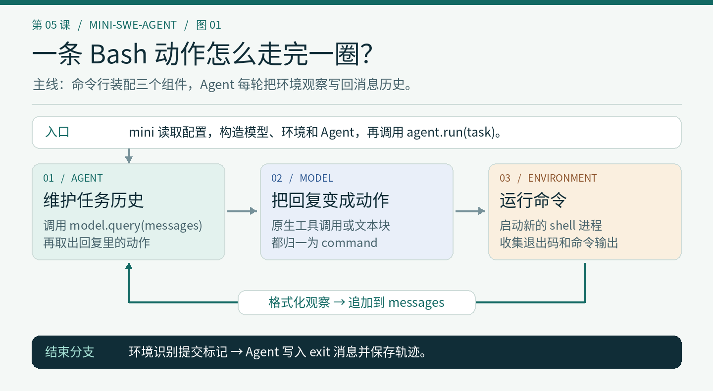
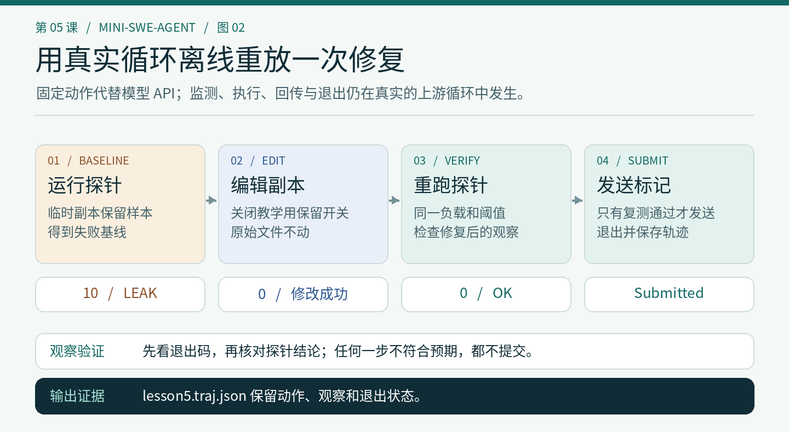
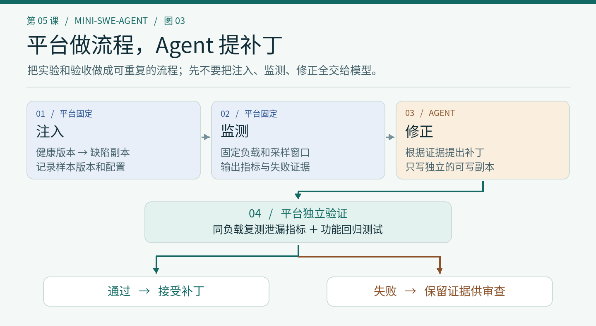

# 第 05 课｜顺着 mini-SWE-agent 的源码走完一次修复

**适合谁：**懂 LLM 的基本概念，刚开始写 Agent，想做「内存泄漏注入 → 监测 → 修正」平台。  
**学完能做什么：**用自己的话讲清楚一条 Bash 动作怎样从模型走到环境、怎样变成下一轮的观察、以及谁判定任务结束；用真实的上游 Agent 循环离线重放一次泄漏修复。阅读加动手约 45–60 分钟。

> 本课锁定 [上游源码 04d809c][tree]（源码中的版本号为 2.4.6）。GitHub 默认分支会继续更新；遇到和视频或旧博客不一样的地方，以本课锁定的代码为准。阅读的是从普通命令行入口到提交退出的完整主链路，不需要先读所有模型供应商和评测适配器。

## 1. 从前四课接过来：这次只给 Agent 一种工具

| 之前学了什么 | 在 mini-SWE-agent 里找什么 |
| --- | --- |
| [01 · Building Effective Agents](../01-building-effective-agents/README.md)：先做一个能跑的循环；[第 1 课的玩具项目](../01-building-effective-agents/code/) | 保留「复现 → 修改 → 用同一个检测器复测」，把每次运行的结果写成轨迹 |
| [02 · LLM-powered Autonomous Agents](../02-llm-powered-autonomous-agents/README.md)：规划、记忆、工具 | 规划主要由模型结合提示与历史完成；`messages` 是本轮任务的工作记录，不等于跨任务长期记忆 |
| [03 · ReAct](../03-react-reasoning-and-acting/README.md)：[从文本提取动作](../03-react-reasoning-and-acting/code/react_text_agent.py) | 对照文本模式：模型写约定的代码块，解析器抽出命令，再把环境结果送回模型 |
| [04 · HF Agents Course](../04-hf-agents-course/README.md)：[结构化工具调用](../04-hf-agents-course/code/structured_tool_agent.py) | 对照默认模式：工具名和参数单独传输，但这里只注册一种 `bash` 工具 |

只有一个工具，不等于只能做一件事。读取文件、运行检测和修改代码都能用命令完成。少掉的是多工具分发的代码，不是权限或风险。先记住三层的分工：**模型提出动作，环境执行动作，Agent 决定继续、停止并保存记录。**



## 2. 按这个顺序读源码：入口 → 循环 → 两端 → 退出

### ① 从 `mini` 找到组装点

打开 [`pyproject.toml`][project] 的 `[project.scripts]`：`mini` 和 `mini-swe-agent` 都指向 [`run/mini.py`][mini] 的 `app`。进入 `main()`，先看它怎样合并配置，再找这几行：

```python
model = get_model(config=config.get("model", {}))
env = get_environment(config.get("environment", {}), default_type="local")
agent = get_agent(model, env, config.get("agent", {}), default_type="interactive")
agent.run(run_task)
```

这就是组装点。默认是交互式 Agent、在本机执行、用 `mini.yaml` 配置；[包入口的 `Model` / `Environment` / `Agent` 协议][protocol] 定义了组件要提供的方法。若想先看不经过工厂的写法，打开 [`run/hello_world.py`][hello] 的 `main()`：它直接构造 `DefaultAgent(LitellmModel(...), LocalEnvironment(), ...)`。这也是本课离线回放的组装方式，只换掉了模型。

### ② 先理解 `DefaultAgent` 的一轮，再看交互层

打开 [`agents/default.py`][default]。按下面的调用顺序读，不必从类的第一行往下背：

1. **`run(task)`**：用 Jinja 的 `_render_template()` 把系统提示和任务提示变成头两条消息，然后反复调用 `step()`。初始用户消息不是直接塞入裸任务文本，而是把 `task` 填进 `instance_template`。
2. **`step()`**：核心就一行：`return self.execute_actions(self.query())`。
3. **`query()`**：先检查步数、成本、墙钟时间，再把 `messages` 交给模型，将回复和成本记下来。预算在查询前检查，不等于在命令执行到一半时自动杀掉进程；命令超时是环境的另一层限制。
4. **`execute_actions()`**：取 `message["extra"]["actions"]`（没有动作时默认空列表），依次交给 `env.execute(action)`。通过 `model.format_observation_messages(...)` 生成观察，再用 `add_messages(...)` 追加，下一轮才看得到。格式错误走 `FormatError` 路径，不会把坏格式交给 shell；单次格式错误通常带着纠错消息继续，达到连续错误上限则 `RepeatedFormatError` 退出。
5. **`save()` / `serialize()`**：`run()` 每轮在 `finally` 中保存（配置了路径才落盘）。轨迹包括消息、调用数、成本和退出状态；它是复盘记录，不是自动恢复任务的检查点。

然后打开 [`agents/interactive.py`][interactive] 的 `InteractiveAgent.execute_actions()`：默认确认模式在执行前询问人；捕获 `Submitted` 后，`_check_for_new_task_or_submit()` 决定是退出还是继续接任务。**平时运行 `mini` 先走这个交互层；核心循环仍在 `DefaultAgent`。**

### ③ 模型适配器：两种传法，同一个动作

默认 [`config/mini.yaml`][config] 配合模型工厂 [`models/__init__.py`][model-factory] 的默认 `LitellmModel`。在 [`models/litellm_model.py`][model] 找 `_query()`：它调用 `litellm.completion(..., tools=[BASH_TOOL])`。顺着 `_parse_actions()` 去 [`models/utils/actions_toolcall.py`][toolcall]：读取 JSON 参数，检查工具名是 `bash` 且有 `command`，保留 `tool_call_id`。后者用来把工具结果配对到哪一次调用；不是 shell 的进程 ID。一个回复可以有多次合法 Bash 调用，循环依次处理。

对照 [`models/litellm_textbased_model.py`][textmodel] 的 `LitellmTextbasedModel._parse_actions()`：它不依赖原生工具调用，交给 [`models/utils/actions_text.py` 的 `parse_regex_actions()`][textactions]，从类似下面的文本中抽出**恰好一个**动作：

````text
```mswea_bash_command
pwd
```
````

两条路最后都提供类似 `{"command": "pwd"}` 的动作字典。默认工具模式把观察作为工具结果，文本模式则把观察包装成用户消息。要从 CLI 使用文本模式，提示和模型适配器必须一起换：`-c mini_textbased.yaml --model-class litellm_textbased`。不要只换提示，也不要把 [`config/default.yaml`][default-config] 的文本模板误认为 `mini` 默认加载的配置；它被 `hello_world.py` 单独读取（该极简入口当前仍直接构造 `LitellmModel`，读组装方式即可）。

键值覆盖由 [`config/__init__.py` 的 `get_config_from_spec()`][load-config] 处理。例如 `-c mini.yaml -c agent.step_limit=8` 会先加载基础配置再覆盖步数。**只写** `-c agent.step_limit=8` 不会自动带入默认配置。观察模板也在 YAML 里，可控制回传给模型的输出长度；这和环境实际执行的命令是两回事。

### ④ 环境：Bash 是工具约定，不是 PowerShell 的别名

读 [`environments/local.py`][local] 的 `LocalEnvironment.execute()` 和模块函数 `_run()`：取出命令与工作目录，用 `subprocess.Popen(..., shell=True, ...)` 新建进程，合并标准输出和标准错误，再记录 `returncode`、`output`、`exception_info`。真实使用的是平台的默认 shell：Linux 上通常是 `/bin/sh`，不保证支持 Bash 专有语法；Windows 原生环境也不会因为工具叫 `bash` 就改用 Bash。

对照 [`environments/docker.py`][docker]：`DockerEnvironment._start_container()` 启动容器；`execute()` 对同一个容器运行 `docker exec`，默认解释器是 `["bash", "-lc"]`。**文件能留到下一轮，但一次命令里的 `cd` 或 `export` 不会留到下一个 shell。** 需要固定目录就配置工作目录，或在同一条命令中串联操作。

### ⑤ 退出信号：说「修完了」不等于退出，更不等于修好了

在本地环境里，`execute()` 把结果交给 `_check_finished()`。这里看的是**输出和退出码**，不是模型写了什么看法：

```python
lines = output.get("output", "").lstrip().splitlines(keepends=True)
if lines and lines[0].strip() == "COMPLETE_TASK_AND_SUBMIT_FINAL_OUTPUT" and output["returncode"] == 0:
    submission = "".join(lines[1:])
```

因此正常结束时执行 `echo COMPLETE_TASK_AND_SUBMIT_FINAL_OUTPUT`；在它前面打印普通日志，或者进程返回非零，都不会满足条件。环境命中条件后抛出 [`exceptions.py`][exceptions] 的 `Submitted`，携带 `role="exit"` 和 `extra.exit_status="Submitted"` 的消息。交互入口可能先请人确认；最终 `DefaultAgent.run()` 把退出消息追加到历史、保存轨迹，看见最后一条消息是 `exit` 才跳出循环。标记之后的输出是 `submission`，不是自动生成的补丁；本课只打印标记，所以提交正文为空。

**读完主链路后想继续：** [`run/utilities/mini_extra.py`][extra] 是辅助命令的分发入口；[`run/utilities/inspector.py`][inspect] 读轨迹并按轮分组。批量评测看 [`run/benchmarks/swebench.py` 的 `process_instance()`][bench]，它消费 `run()` 的退出状态和提交内容；[评测专用模板][bench-config] 才明确要求通过标记之后的输出提交补丁。有了上面的地图，再按需读其它模型和环境的适配器即可。

## 3. 动手：在 Windows 上重放一次「检测失败 → 改代码 → 检测通过」

先把 ZIP **解压到** `E:\学习笔记\agent`，得到 `E:\学习笔记\agent\05-mini-swe-agent\README.md`。以前的四个文件夹与本课同级时，上面的相对链接就能一起使用。本课的小样本是自包含的，不会改第 1 课的文件。

### A. 在 PowerShell 看见「泄漏」

有 Windows Python 3.10+ 和 `py` 启动器即可，不用装 Agent：

```powershell
Set-Location 'E:\学习笔记\agent\05-mini-swe-agent'
python .\code\leak_probe.py
$LASTEXITCODE
```

你应看到 `retained=128`、`LEAK`，退出码是 **10**，这是预设的失败基线，不是安装失败。每批生成 32 个 4 KiB 的样本，跑 4 批；`RETAIN = True` 让列表跨批次继续引用样本。这个例子只多保留约半 MiB，演示的是对象生命周期问题，不是无限耗尽内存。检测使用 `tracemalloc` 的当前 Python 分配增长量判定，不是进程 RSS；具体字节数会随运行环境变化。

### B. 在 WSL 走上游循环，不用 API Key

Windows 上建议用 WSL 2。若没安装 WSL，用管理员 PowerShell 执行下面的安装命令；如果系统要求重启，重启并完成 Ubuntu 首次设置后再进入。已有 Ubuntu 可直接运行第二行。

```powershell
wsl --install -d Ubuntu
wsl -d Ubuntu
```

下列命令在 **Ubuntu / WSL 的 shell** 里执行；按默认挂载，Windows 的 `E:` 对应 `/mnt/e`。依赖安装需要联网；安装完成后离线回放不调用模型 API。不需要激活虚拟环境，下面直接使用它的 Python：

```bash
sudo apt update
sudo apt install -y git python3 python3-venv
mkdir -p ~/agent-lesson5
cd ~/agent-lesson5
git clone https://github.com/SWE-agent/mini-swe-agent.git
git -C mini-swe-agent checkout 04d809ceab9df28f9adaed044884180159172930
python3 -m venv .venv
.venv/bin/python -m pip install ./mini-swe-agent
.venv/bin/mini --help
LITELLM_LOCAL_MODEL_COST_MAP=True .venv/bin/python \
  '/mnt/e/学习笔记/agent/05-mini-swe-agent/code/offline_replay.py'
```

若 `/mnt/e` 不存在或不可读，在 Ubuntu 文件系统里另存一份解压后的 `05-mini-swe-agent`，再用对应路径执行。Docker 是可选替代：可以在有 Python、Git、Bash 的 Linux 容器里重放本课，或让上游用 `DockerEnvironment` 执行任务。二者不是一回事；本例实际用的是 WSL/Linux 的 `LocalEnvironment`，没有启动 Docker。**WSL 不是安全沙箱**，默认还能访问挂载的 Windows 文件。不要让真实模型在存有凭据、个人文件或生产代码的环境里执行任意命令。



关键输出形如（字节数省略）：

```text
returncode=10 | retained=128 growth_bytes=… peak_bytes=… | LEAK
returncode=0 | patch applied
returncode=0 | retained=0 growth_bytes=… peak_bytes=… | OK
exit_status=Submitted
```

打开 [`code/offline_replay.py`](code/offline_replay.py) 找三样东西：

- `CheckedReplay` 继承上游 `DeterministicModel`：按固定顺序返回预写动作，并在每次查询前核对上一轮观察。它**不会推理或生成修法**。先用它验证你理解了闭环，再考虑接入真实模型。
- `TemporaryDirectory` 里的才是可编辑副本。四步动作是测量、关闭这个教学用保留开关、原样复测、发送结束标记。提交前如果复测不是 `OK`，回放会报错，不会伪造成功。这里没有通用的「关闭缓存」修法；现实中要保留业务需要的引用，给它明确的释放点或容量上限。
- `output_path` 默认把轨迹 `lesson5.traj.json` 写到当前目录，同名文件会被更新。用编辑器查看，或者执行 `.venv/bin/mini-extra inspect lesson5.traj.json`。在 `messages` 中找 `assistant.extra.actions`、三个观察的 `extra.returncode`（`10 → 0 → 0`）和最后的 `exit`；然后对照 `info.exit_status`。最终提交动作由环境抛出完成信号，不是第四条普通观察。

## 4. 怎样迁移到你的内存泄漏平台

先写**固定流程**，只在「提出修复」上给 Agent 自由。第一个可交付版本只做一个可控样本、一条检测命令、一次代码修复；暂时不做多 Agent。



| 阶段 | 谁来控制 | 输入与输出 |
| --- | --- | --- |
| 注入 | 平台在隔离副本内启用已知缺陷 | 健康版本 + 场景配置 → 带缺陷样本，记下注入版本 |
| 监测 | 固定脚本，不让模型凭印象判定 | 同一负载、固定预热和采样窗口 → 样本序列、增长量、阈值、退出码和日志 |
| 修正 | Agent 阅读证据，在另一份可写副本提出补丁 | 缺陷版本 + 报告 → 补丁和轨迹；限制目录、运行时间、可用资源 |
| 验证 | 平台独立重跑固定检测和功能回归 | 同负载的前后指标 + 功能测试 → 通过才接受；失败保留轨迹和补丁供人审查 |

起步时记录健康、注入、修复后三组数据。真实服务里 RSS 上升也可能来自预热、分配器缓存或正常缓存；用重复实验确认持续增长，并选择运行时适用的指标。不要让候选补丁修改独立验证器或阈值；也不要把模型输出的 `Submitted` 当成「无内存泄漏」。真实接模型前，先在隔离环境中审核每条命令，不转发密钥，不挂载个人目录或 Docker socket；同时设定资源上限，这些措施不能只靠提示词。

### 自测三题

1. 在配置的工作目录里，上一条动作执行了 `cd /tmp`；下一条 `pwd` 在哪里？  
   **答：**在配置的工作目录；`cd` 不会跨动作。用 `cd /tmp && pwd` 才是在同一 shell 内切换。
2. 工具没有执行，只在助手文本中写了 `COMPLETE_TASK_AND_SUBMIT_FINAL_OUTPUT`，会退出吗？  
   **答：**不会。结束条件由环境检查命令结果，而不是从助手发言里查找词串。
3. 如果第二次检测仍返回 10，怎样区分「任务停止」与「修复成功」？  
   **答：**本例会中止并留下错误轨迹；真实平台同样应使用独立验证结论，不把结束状态当成修复成功。

---

延伸阅读：[官方快速开始](https://mini-swe-agent.com/latest/quickstart/) · [官方控制流说明](https://mini-swe-agent.com/latest/advanced/control_flow/)。文中源码节选来自 [SWE-agent/mini-swe-agent（MIT）][license]。

[tree]: https://github.com/SWE-agent/mini-swe-agent/tree/04d809ceab9df28f9adaed044884180159172930
[project]: https://github.com/SWE-agent/mini-swe-agent/blob/04d809ceab9df28f9adaed044884180159172930/pyproject.toml
[mini]: https://github.com/SWE-agent/mini-swe-agent/blob/04d809ceab9df28f9adaed044884180159172930/src/minisweagent/run/mini.py
[protocol]: https://github.com/SWE-agent/mini-swe-agent/blob/04d809ceab9df28f9adaed044884180159172930/src/minisweagent/__init__.py
[hello]: https://github.com/SWE-agent/mini-swe-agent/blob/04d809ceab9df28f9adaed044884180159172930/src/minisweagent/run/hello_world.py
[default]: https://github.com/SWE-agent/mini-swe-agent/blob/04d809ceab9df28f9adaed044884180159172930/src/minisweagent/agents/default.py
[interactive]: https://github.com/SWE-agent/mini-swe-agent/blob/04d809ceab9df28f9adaed044884180159172930/src/minisweagent/agents/interactive.py
[config]: https://github.com/SWE-agent/mini-swe-agent/blob/04d809ceab9df28f9adaed044884180159172930/src/minisweagent/config/mini.yaml
[default-config]: https://github.com/SWE-agent/mini-swe-agent/blob/04d809ceab9df28f9adaed044884180159172930/src/minisweagent/config/default.yaml
[load-config]: https://github.com/SWE-agent/mini-swe-agent/blob/04d809ceab9df28f9adaed044884180159172930/src/minisweagent/config/__init__.py
[model-factory]: https://github.com/SWE-agent/mini-swe-agent/blob/04d809ceab9df28f9adaed044884180159172930/src/minisweagent/models/__init__.py
[model]: https://github.com/SWE-agent/mini-swe-agent/blob/04d809ceab9df28f9adaed044884180159172930/src/minisweagent/models/litellm_model.py
[toolcall]: https://github.com/SWE-agent/mini-swe-agent/blob/04d809ceab9df28f9adaed044884180159172930/src/minisweagent/models/utils/actions_toolcall.py
[textmodel]: https://github.com/SWE-agent/mini-swe-agent/blob/04d809ceab9df28f9adaed044884180159172930/src/minisweagent/models/litellm_textbased_model.py
[textactions]: https://github.com/SWE-agent/mini-swe-agent/blob/04d809ceab9df28f9adaed044884180159172930/src/minisweagent/models/utils/actions_text.py
[local]: https://github.com/SWE-agent/mini-swe-agent/blob/04d809ceab9df28f9adaed044884180159172930/src/minisweagent/environments/local.py
[docker]: https://github.com/SWE-agent/mini-swe-agent/blob/04d809ceab9df28f9adaed044884180159172930/src/minisweagent/environments/docker.py
[exceptions]: https://github.com/SWE-agent/mini-swe-agent/blob/04d809ceab9df28f9adaed044884180159172930/src/minisweagent/exceptions.py
[extra]: https://github.com/SWE-agent/mini-swe-agent/blob/04d809ceab9df28f9adaed044884180159172930/src/minisweagent/run/utilities/mini_extra.py
[inspect]: https://github.com/SWE-agent/mini-swe-agent/blob/04d809ceab9df28f9adaed044884180159172930/src/minisweagent/run/utilities/inspector.py
[bench]: https://github.com/SWE-agent/mini-swe-agent/blob/04d809ceab9df28f9adaed044884180159172930/src/minisweagent/run/benchmarks/swebench.py
[bench-config]: https://github.com/SWE-agent/mini-swe-agent/blob/04d809ceab9df28f9adaed044884180159172930/src/minisweagent/config/benchmarks/swebench.yaml
[license]: https://github.com/SWE-agent/mini-swe-agent/blob/04d809ceab9df28f9adaed044884180159172930/LICENSE.md
