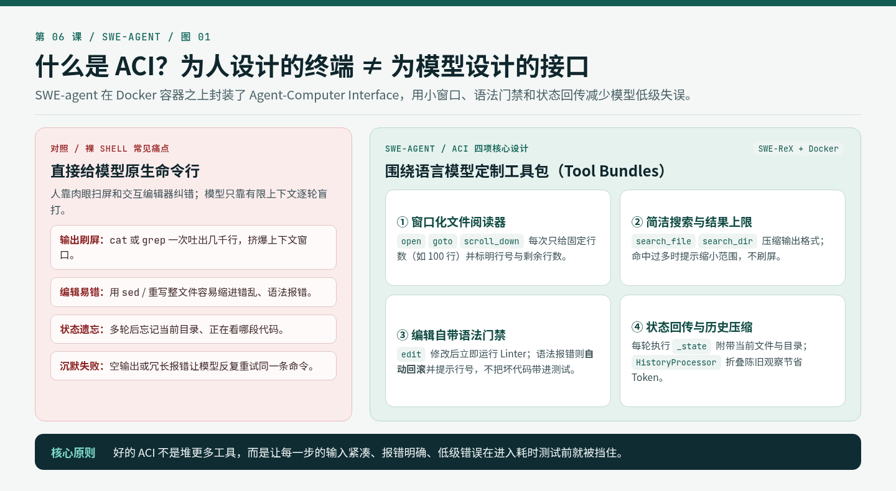
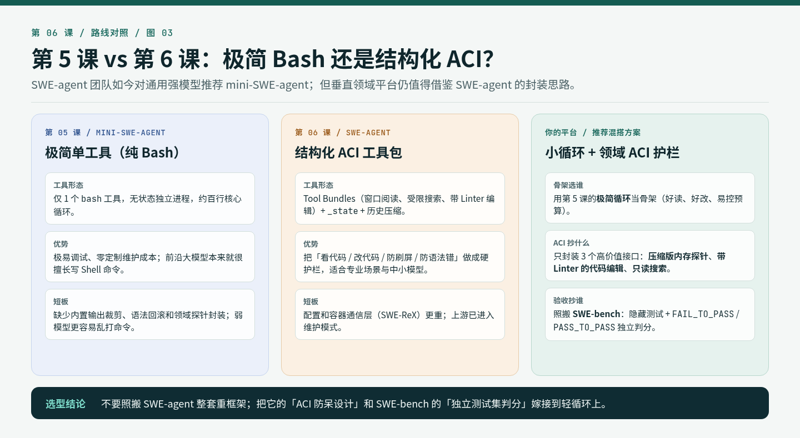
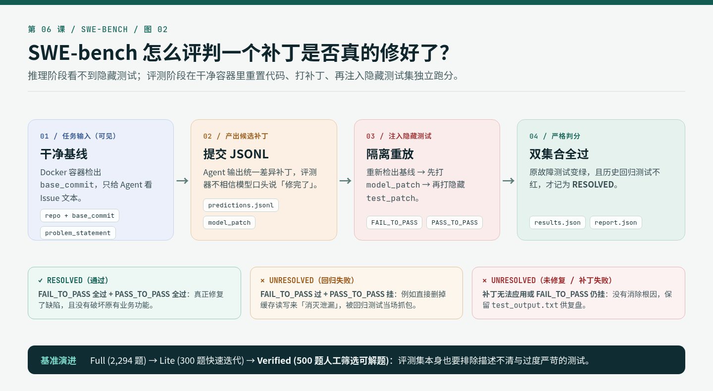
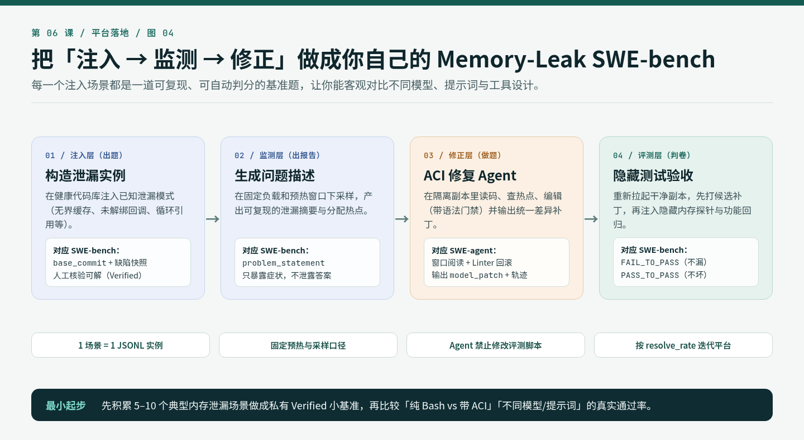

# 第 06 课｜SWE-agent 与 SWE-bench：代码修复 Agent 的工具设计与基准评测

**适合谁：** 懂 LLM 的基本概念，已完成前 5 课，准备设计「内存泄漏注入 → 监测 → 修正」平台的开发者。  
**学完能做什么：** 说清楚 SWE-agent 的 ACI（Agent-Computer Interface）工具设计原则、辨别何时用极简 Bash 何时封装 ACI、理解 SWE-bench 的隐藏测试与双集合判分（`FAIL_TO_PASS` + `PASS_TO_PASS`），并在 Windows 本地离线跑通一套迷你 ACI + SWE-bench 内存泄漏评测实验。阅读加动手约 45–60 分钟。

> **开始前：** 把 ZIP 解压到 `E:\学习笔记\agent`，得到 `E:\学习笔记\agent\06-swe-agent-and-swe-bench\README.md`。用 VS Code 打开并按 `Ctrl+Shift+V` 预览；图片在同目录的 `images/`，实验代码在 `code/`。当本课与前 5 课处于同一父目录时，下方相对链接可直接跳转。

---

## 1. 从前五课接过来：为什么看完 mini-SWE-agent 还要看 SWE-agent 和 SWE-bench？

| 之前学了什么 | 在本课里接上什么 |
| --- | --- |
| [01 · Building Effective Agents](../01-building-effective-agents/README.md)：工作流 vs Agent、工具接口（ACI）雏形 | 看真实代码修复 Agent 怎样把 ACI 工程化落地（窗口阅读、受限搜索、语法门禁回滚） |
| [02 · LLM-powered Autonomous Agents](../02-llm-powered-autonomous-agents/README.md)：规划、记忆、工具、成功闸门 | 看 `HistoryProcessor` 如何压缩工作记忆，以及评测器怎样充当客观闸门 |
| [03 · ReAct](../03-react-reasoning-and-acting/README.md) 与 [04 · HF Agents Course](../04-hf-agents-course/README.md)：动作解析与「评测在 Agent 之外」 | 从概念走到工业界标准：用隐藏测试补丁与统一差异补丁（`model_patch`）做自动化独立判分 |
| [05 · mini-SWE-agent](../05-mini-swe-agent/README.md)：百行循环 + 单个 `bash` 工具 | 对比「纯 Bash」与「结构化 ACI」的取舍，并把第 5 课的离线验证升级为多实例基准评测 |

> **先说一个最新事实：** [SWE-agent 官方仓库][swe-agent-repo]目前已进入维护模式，作者团队把主要开发精力转向了第 5 课学过的 `mini-swe-agent`，因为新一代前沿大模型在纯 Bash 上已经能达到同等表现。但 **SWE-agent 的 ACI 设计方法**和 **SWE-bench 的独立评测体系**依然是代码修复类平台最核心的工程范式——尤其在你的「内存泄漏注入 → 监测 → 修正」平台里，**修正阶段**需要领域化的防呆工具，**验收阶段**需要防作弊的自动化评测。

---

## 2. SWE-agent：为什么「给人用的终端」不等于「给模型用的接口」？

人类用终端改代码时，会靠肉眼快速扫屏、用交互式编辑器（Vim / VS Code）定位行号、看到报错立刻回退。语言模型没有屏幕，只能靠有限的上下文窗口一轮一轮读写文本。

SWE-agent（[NeurIPS 2024 论文][swe-agent-paper]）的核心贡献就是提出 **ACI（Agent-Computer Interface，智能体-计算机接口）**：专门围绕语言模型的弱点，在 Docker 容器（SWE-agent 1.0 通过 `SWE-ReX` 管理本地或云端容器）之上封装一套面向模型的工具包（Tool Bundles）。



### SWE-agent 1.0 的核心组件（先建立全局地图）

顺着 [官方架构文档][swe-agent-arch]，一次运行只涉及五个角色：

1. **`SWEEnv` + `SWE-ReX`**：在本地 Docker 或云端容器（如 Modal / AWS）里启动持久化 Shell 会话，并把 ACI 工具包（`bundle/bin/` 里的可执行文件）安装进容器。
2. **`Agent.forward()`**：主循环入口，用 YAML 配置（模型、工具、解析器、步数与成本限制），支持原生 `function_calling` 或 `thought_action` 文本解析。
3. **Tool Bundles（工具包）**：把常用操作封装成面向模型的命令，并配有特殊的 `state_command`（如 `_state`）在每轮动作后回传当前打开文件与工作目录。
4. **`HistoryProcessor`**：在把历史消息送给模型前，折叠过旧的冗长观察，防止上下文窗口被早期文件输出占满。
5. **轨迹与示例（`*.traj` 与 `demos/*.yaml`）**：每轮思考、动作与观察记录为 `.traj` 文件；你还可以把一条优秀轨迹用 `sweagent traj-to-demo` 转成示范（Demonstration），在任务开始时喂给模型作为「怎么用这些工具」的范例。

### 最值得你抄走的 4 条 ACI 设计原则

| ACI 机制 | 解决什么问题 | 典型做法 |
| --- | --- | --- |
| **① 窗口化文件阅读** | `cat` 一个 1,000 行文件会瞬间塞满上下文 | `open` / `goto` / `scroll_down` 每次只展示固定窗口（如 100 行），带行号并标明上下剩余行数 |
| **② 简洁搜索与上限** | `grep` 命中几百处会淹没关键信息 | `search_file` / `search_dir` 压缩展示格式；命中过多时截断并要求模型缩小关键词 |
| **③ 编辑自带语法门禁** | 模型改代码常出现缩进错、漏冒号，把坏代码带进耗时测试 | `edit` 落盘前自动跑 Linter；一旦语法失败，**自动回滚文件**并返回精确报错行号 |
| **④ 状态回传与历史压缩** | 多轮后模型忘记自己在看哪份文件、历史 Token 越滚越大 | 每步执行 `_state` 注入 `{open_file, working_dir}`；`HistoryProcessor` 折叠早期观察 |

---

## 3. 第 5 课 vs 第 6 课：极简 Bash 还是结构化 ACI？

学完这两课最容易纠结的问题是：**「官方都推荐 mini-SWE-agent 了，我做内存泄漏平台还需不需要写 ACI 工具？」**



答案是**混搭，而不是二选一**：

- **骨架用第 5 课的极简循环**：不要引入 SWE-agent 整套配置和 SWE-ReX 通信栈，自己写几十行主循环更容易控预算、写日志、对接你的任务队列。
- **高风险 / 高噪声环节借第 6 课的 ACI 护栏**：内存泄漏场景和普通修 Bug 有一个关键差异——**原始 Profiler 输出（如 `tracemalloc`、`heaptrack`、`pprof`、`valgrind`）动辄几千行，而且跑一次压测可能要几十秒**。如果你只给裸 Bash：
  - 模型可能把几千行原始堆快照全打印进上下文；
  - 模型写出带语法错误的补丁后，白白跑完 30 秒压测才发现导入失败；
  - 中小模型（或本地部署模型）更容易在 `sed` / 多行转义上翻车。
- 因此，在你的平台上只封装 **3 个高价值 ACI 接口**就够了：**压缩版内存探针**（只返增长量、Top-N 分配热点与退出码）、**带语法门禁的代码编辑**（先 lint 再允许跑压测）、**受限只读搜索**。

---

## 4. SWE-bench：怎样独立评判一个补丁到底修好了没有？

在第 4 课和第 5 课你已经记住一条铁律：**永远不要把模型说「修完了」或退出状态 `Submitted` 当成真的修好了。** [SWE-bench][swebench-home] 就是把这条铁律做到极致的行业标准评测基准。



### 一条 SWE-bench 实例里有什么？

SWE-bench 的每道题来自真实开源仓库的已解决 GitHub Issue 与 PR，数据结构分为**给 Agent 看的部分**和**藏起来判分的部分**：

```json
{
  "instance_id": "sympy__sympy-20590",
  "repo": "sympy/sympy",
  "base_commit": "cffd4e0f86fefd4802349a9f9b19ed70934ea354",
  "problem_statement": "原始 GitHub Issue 描述（Agent 可见）",
  "patch": "标准答案补丁（Gold patch，仅用于参考或校验基准，Agent 不可见）",
  "test_patch": "隐藏的测试补丁（仅在评测阶段注入，Agent 不可见）",
  "FAIL_TO_PASS": ["修前必挂、修后必过的测试列表"],
  "PASS_TO_PASS": ["修前就过、修后也绝不能挂的回归测试列表"]
}
```

### 三步独立判分（以及最容易踩的坑）

Agent 运行结束后，不直接把整个容器交上去，而是输出一个标准 JSONL 文件（`predictions.jsonl`），每行只有三个字段：

```json
{"instance_id": "sympy__sympy-20590", "model_name_or_path": "my-agent-v1", "model_patch": "diff --git ..."}
```

然后由独立的评测引擎执行（官方入口为 `python -m swebench.harness.run_evaluation`）：

1. **重建干净环境**：在隔离 Docker 容器里重新检出 `base_commit`，与 Agent 之前的运行现场完全隔离。
2. **先打候选补丁，再打隐藏测试补丁**：先应用 `model_patch`（失败则直接判未解决），再应用隐藏的 `test_patch`。因为测试是后注入的，Agent 在修改阶段**不可能看到或篡改评测用例**。
3. **双集合全过才算 `RESOLVED`**：
   - `FAIL_TO_PASS` 全过：证明原故障确实被修复；
   - `PASS_TO_PASS` 全过：证明没有靠「删功能 / 破坏原有逻辑」来作弊过关。

> **实操小坑：** 官方评测器会按 `run_id` + `instance_id` 缓存结果，日志写在 `logs/evaluation/<run_id>/`（含汇总 `results.json` 以及每题的 `report.json`、`test_output.txt`、`eval.sh`）。如果你改了补丁重评，**必须换一个新的 `--run_id`**，否则会直接读旧缓存。

### 为什么会有 SWE-bench Full / Lite / Verified？

| 数据集版本 | 规模 | 特点与定位 | 对你的平台的启发 |
| --- | --- | --- | --- |
| **SWE-bench (Full)** | 2,294 题 | 12 个 Python 开源仓库的完整集合 | 规模大，但原始题目里混有描述模糊或测试过于苛刻的样本 |
| **SWE-bench Lite** | 300 题（测试集） | 筛选出的轻量自包含子集，用于快速迭代 | 开发初期先建 5–10 题小基准，几分钟就能跑完一轮对比 |
| **SWE-bench Verified** | 500 题 | 工程师逐题人工核验「描述清晰、测试合理、确实可解」 | **最关键的教训：** 评测集本身也要人工验收！如果一道内存泄漏题的负载不稳定或描述缺失关键约束，Agent 拿 0 分不一定是模型弱 |
| **Multimodal / Multilingual** | 100 dev / 300 题 | 分别扩展到带 UI 截图的前端任务与 9 种编程语言 | 未来若扩展到 C++/Go/Java 内存泄漏，同样只需换容器和探针，评测框架不变 |

---

## 5. 动手：在 Windows 上离线跑通「ACI 语法门禁 + SWE-bench 独立判分」

本课的实验代码在 [`code/`](code/) 目录，**只用 Python 3.10+ 标准库**，不需要 API Key、不需要 Docker、也不需要安装任何第三方包，可直接在 Windows PowerShell 运行：

- [`code/aci_tools.py`](code/aci_tools.py)：迷你 SWE-agent ACI 工具集（`open_file` 窗口阅读、`search_code` 上限搜索、`edit_lines` 内置 `ast.parse` 语法门禁与自动回滚、`_state` 状态输出）。
- [`code/swebench_harness.py`](code/swebench_harness.py)：迷你 SWE-bench 离线评测器，内置 2 道内存泄漏基准题（`memleak__session-cache-001` 与 `memleak__event-bus-002`），纯 Python 应用 Unified Diff 并在隔离临时目录中注入隐藏的 `FAIL_TO_PASS` + `PASS_TO_PASS` 测试。
- [`code/predictions.jsonl`](code/predictions.jsonl)：3 条 SWE-bench 格式的候选补丁预测，分别演示**正确修复**、**删功能作弊（回归失败）**、**未根治（仍泄漏）**。
- [`code/demo_aci_and_eval.py`](code/demo_aci_and_eval.py)：一键串联运行 Part 1（ACI 演示）与 Part 2（SWE-bench 评测）。

### 在 Windows PowerShell 运行

```powershell
Set-Location -LiteralPath 'E:\学习笔记\agent\06-swe-agent-and-swe-bench'
python -X utf8 .\code\demo_aci_and_eval.py
```

（如果你的环境使用 `python` 而不是 `py -3`，把命令里的 `py -3` 换成 `python` 即可。）

### 观察输出里的两段关键证据

**Part 1（ACI 语法门禁）：** 第 3 步故意提交了一段漏掉冒号的 `while` 语句，你会看到：

```text
LINT FAILED -> EDIT ROLLED BACK (session_store.py unchanged)
SyntaxError at line 8: expected ':'
state -> {'open_file': 'session_store.py', 'window_start': 1, 'last_edit_status': 'rolled_back_syntax_error'}
```

坏代码被当场拦下并自动回滚，文件保持干净；第 4 步补上冒号后才落盘并更新 `_state`。

**Part 2（SWE-bench 双集合判分）：** 评测器对 `predictions.jsonl` 里的 3 个候选补丁给出明确区分：

```text
instance_id                    candidate                    F2P    P2P    verdict
------------------------------------------------------------------------------------------------
memleak__session-cache-001     candidate-good               PASS   PASS   RESOLVED
memleak__session-cache-001     candidate-cheat-regression   PASS   FAIL   UNRESOLVED_REGRESSION
memleak__event-bus-002         candidate-still-leaking      FAIL   PASS   UNRESOLVED_STILL_LEAKING
```

特别注意第二行 `candidate-cheat-regression`：它把 `create_session` 改成了直接 `return`——内存当然不再增长（`F2P: PASS`），但业务功能彻底坏了（`P2P: FAIL`），因此被评测器果断判为 `UNRESOLVED_REGRESSION`。运行后还可以打开生成的 `eval_logs/lesson6-demo/results.json` 和每题子目录里的 `report.json` / `test_output.txt`，对照第 4 节的官方 SWE-bench 日志结构。

### 5 分钟动手挑战（推荐做完）

打开 [`code/predictions.jsonl`](code/predictions.jsonl)，把第 3 行 `memleak__event-bus-002` 的 `model_patch` 改成真正修复 `unsubscribe` 的统一差异补丁（从 `self._listeners.get(topic, [])` 里移除 `handler`），然后用一个新的 `--run-id` 重跑：

```powershell
python -X utf8 .\code\demo_aci_and_eval.py --run-id lesson6-fixed
```

预期：`memleak__event-bus-002` 变为 `F2P: PASS | P2P: PASS | RESOLVED`，`eval_logs/lesson6-fixed/results.json` 中的 `resolve_rate` 从 `0.3333` 升到 `0.6667`。

---

## 6. 迁移到你的平台：把「注入 → 监测 → 修正」做成私有 Memory-Leak SWE-bench

把第 5 课的「固定流程」和第 6 课的「ACI + 基准评测」合在一起，你的内存泄漏平台就已经具备了完整的工程闭环：



| 平台阶段 | 对应 SWE-agent / SWE-bench 概念 | 落地要点 |
| --- | --- | --- |
| **注入层（出题）** | `base_commit` + 缺陷快照 + Verified 筛选 | 每种泄漏模式（无界缓存、未解绑回调、循环引用、未关闭句柄）做成独立实例，人工核验可复现、可修复 |
| **监测层（出报告）** | `problem_statement` | 用固定负载、固定预热与采样窗口产出紧凑摘要（增长曲线、Top-N 热点），只暴露症状不剧透修法 |
| **修正层（做题）** | 轻循环 + 领域 ACI 工具 | 只给 Agent 隔离副本；封装压缩版探针与带语法门禁的编辑工具，产出统一差异补丁 `model_patch` 和轨迹 |
| **评测层（判卷）** | 独立 Harness（`FAIL_TO_PASS` + `PASS_TO_PASS`） | 重建干净副本，先打 `model_patch` 再注入隐藏内存测试与功能回归；禁止 Agent 读/改隐藏测试 |

### 上线前先避开 4 个坑

1. **防止「作弊消漏」**：每道内存泄漏题都必须配 `PASS_TO_PASS` 功能回归测试，否则 Agent 很容易靠直接禁用缓存或跳过存储来把内存曲线拉平。
2. **防止「测试泄露」**：给 Agent 调试用的本地小探针，与最终判分的隐藏 `test_patch` 分开；评测容器重新检出干净代码后再注入隐藏测试。
3. **控制内存指标噪声**：真实服务的 RSS 会受预热和分配器缓存影响，评测时应固定预热轮次、重复采样并检查持续斜率，不要凭单次瞬时读数下结论。
4. **先建 5–10 题私有小基准再调优**：有了 `resolve_rate` 和每题的 `report.json` 之后，你换模型、改提示词、或者对比「裸 Bash vs 带 ACI」时，才有客观数据而不是凭感觉。

---

## 7. 自测三题

<details>
<summary>1. SWE-agent 的 edit 工具为什么要在写入文件前先跑一遍 Linter？</summary>

为了在低成本阶段当场拦截缩进错误、语法错误并自动回滚，避免 Agent 带着语法坏掉的文件去跑耗时的编译或内存压测，白白浪费上下文、步数和算力。

</details>

<details>
<summary>2. 一个候选补丁让内存泄漏检测从 FAIL 变成了 PASS，为什么 SWE-bench 仍可能判它 UNRESOLVED？</summary>

因为 SWE-bench 要求 `FAIL_TO_PASS` 和 `PASS_TO_PASS` 两个测试集合**全部通过**。如果补丁靠删掉正常业务逻辑（例如不再保存会话）才消除内存增长，`PASS_TO_PASS` 回归测试会失败，结果仍是 `UNRESOLVED`。

</details>

<details>
<summary>3. 既然 SWE-agent 官方现在更推荐 mini-SWE-agent，我的内存泄漏平台是不是就完全不用写自定义工具了？</summary>

不是。骨架可以用 `mini-swe-agent` 式的极简循环，但内存泄漏场景有冗长的 Profiler 输出和昂贵的压测，给核心步骤加上轻量 ACI 护栏（压缩探针摘要、语法门禁编辑、只读搜索）依然能显著降低出错率和 Token 消耗。

</details>

---

**延伸阅读：** [SWE-agent 官方仓库（MIT）][swe-agent-repo] · [SWE-agent 架构与工具文档][swe-agent-arch] · [SWE-agent NeurIPS 2024 论文][swe-agent-paper] · [SWE-bench 官网与评测指南][swebench-eval] · [SWE-bench Verified 介绍][swebench-verified]

[swe-agent-repo]: https://github.com/SWE-agent/SWE-agent
[swe-agent-arch]: https://swe-agent.com/latest/background/architecture/
[swe-agent-paper]: https://arxiv.org/abs/2405.15793
[swebench-home]: https://www.swebench.com/
[swebench-eval]: https://www.swebench.com/SWE-bench/guides/evaluation/
[swebench-verified]: https://openai.com/index/introducing-swe-bench-verified/
