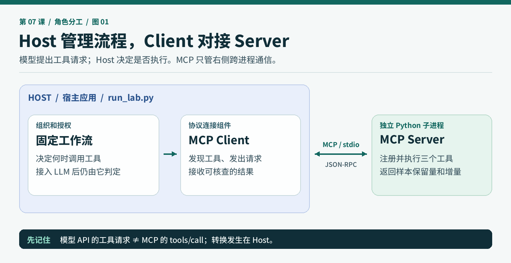
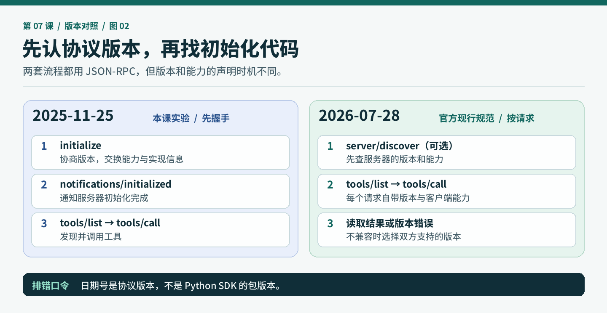
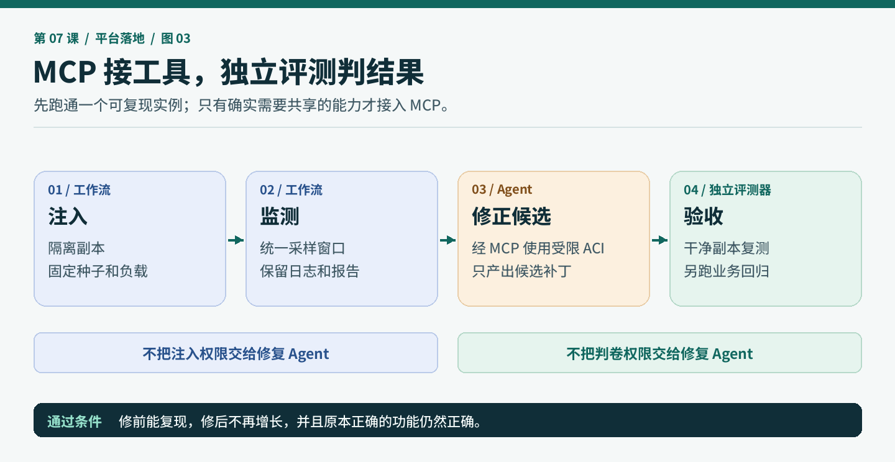

# 第 07 课｜Model Context Protocol：让 Agent 用同一种协议连接工具

**适合谁：**懂 LLM 的基本概念，已经跟过前六课，想把「内存泄漏注入 → 监测 → 修正」做成一个平台。建议阅读 25 分钟、动手 20 分钟。

**学完能做什么：**画出 Host、Client 和 Server 的边界；说出模型的工具调用与 MCP 调用的区别；在 Windows 上运行一个不需要 API Key 的本地 MCP 实验，用修复前后的数据判定是否通过。

> **开始前：**把 ZIP 解压到 `E:\学习笔记\agent`，得到 `E:\学习笔记\agent\07-model-context-protocol\README.md`。用 VS Code 打开本页，按 `Ctrl+Shift+V` 预览。保留 `images/` 和 `code/` 在本页旁边；正文和图片不需要联网。

## 1. 先接着第 6 课问：工具写好了，怎么让另一个 Agent 也用它？

第 6 课的 `WorkspaceACI` 已经给修复 Agent 一套好用的操作：读窗口、搜索、按行编辑、失败时回滚。若第二个 Host 不是 Python 写的，它就不能直接导入这个类。与其为每个 Host 重写一套对接，不如把操作放到一个服务里，让各个 Host 用同样的方式**发现工具、传参数、接结果**。这就是 **MCP（Model Context Protocol）** 解决的问题。

**ACI 决定工具长什么样；MCP 决定工具怎么接过来。** 把一个无限制的 Bash 工具搬到 MCP 上，并不会自动变成好用或安全的 ACI。同样，MCP 不负责挑选模型、驱动 ReAct 循环，也不负责判定补丁是不是正确。



*图 1：MCP 只覆盖 Client 与 Server 之间的边界。*

| 角色 | 负责什么 | 这次实验里的对应物 |
| --- | --- | --- |
| Host（宿主应用） | 管理工具权限、上下文和流程；需要时调用 LLM | `run_lab.py` 的固定剧本，不调用 LLM |
| Client（客户端组件） | 在 Host 内与一个 Server 交换 MCP 消息；一个 Host 可管理多个 Client | `ClientSession` 加上 `stdio_client` |
| Server（服务端） | 提供实际能力，校验输入并返回结果 | `leak_server.py`，在独立 Python 子进程里运行 |

把第 4 课的结构化调用接上来：模型 API 可能返回一个叫 `probe_leak` 的工具请求；**Host** 校验并把它交给 **Client**，后者才发送 MCP `tools/call`。结果先回到 Host，由它决定哪些数据作为下一轮观察交给模型。模型不会直接写入服务器的管道。

## 2. Server 可以提供三类东西

| 能力 | 方法 | 在你的平台怎么选 |
| --- | --- | --- |
| **Tools（工具）** | `tools/list` → `tools/call` | 要做事：发起一次采样、在实验副本上提交修复候选。可由模型提出，也可由工作流直接调用。 |
| **Resources（资源）** | `resources/list` → `resources/read`；也可用 URI 模板发现 | 要读已有数据：按 URI 读取一份已生成的采样报告；由应用决定读哪份。生成新报告则更像工具。 |
| **Prompts（提示模板）** | `prompts/list` → `prompts/get` | 供用户挑选的可复用模板，例如「比较两次采样并列出可疑引用」。它提供消息，不执行比较。 |

「模型调用、应用选择、用户选择」是设计取向，**不是授权机制**。目录里的工具描述和 JSON Schema 能告诉 Host 怎样传参，不能告诉它这次调用已经获得授权。一个 Server 不必三类都提供；本实验只提供 Tools。

## 3. 从发现工具到执行：看懂消息与传输

**消息层：**MCP 用 JSON-RPC 2.0 表达远程调用。下面是本课连接建立后可能发出的两条请求（编号仅用于举例）：

```json
{"jsonrpc":"2.0","id":1,"method":"tools/list"}
{"jsonrpc":"2.0","id":2,"method":"tools/call","params":{"name":"probe_leak","arguments":{}}}
```

`tools/list` 返回工具目录，包含名称、输入 Schema 等；`tools/call` 才执行函数。响应带同一个 `id`，所以 Client 知道结果对应哪次请求；通知没有 `id`，不等响应。工具有结构化结果时，可从 `structuredContent` 取字段。本实验直接读取 `growth_payload_bytes`，不用从「似乎泄漏了」这样的话里猜测状态。还要区分 RPC 调用错误（例如方法不存在）、工具执行失败（`isError`）与一次**成功检测到泄漏**（`GROWING`，是正常返回的业务结果）。

**传输层：**决定这些消息走什么通道。

| 传输 | 消息怎么走 | 何时用 |
| --- | --- | --- |
| **stdio** | Client 一般启动 Server 子进程，写它的 `stdin`、读它的 `stdout`；每行一条 JSON-RPC 消息 | 先做本机实验。不监听网络端口；Server 业务日志走 `stderr`，不要用普通 `print()` 污染协议流。 |
| **Streamable HTTP** | Client 向 MCP endpoint 发 HTTP POST；Server 可回 JSON 或用 SSE（Server-Sent Events）流式返回。具体会话、订阅规则随版本不同。 | 工具要独立部署或由多个 Host 使用；要考虑 TLS、认证、授权、超时等。Streamable HTTP 可以用 SSE，但不是旧版的独立 HTTP+SSE 传输。 |



*图 2：阅读教程时先看它使用的协议版本，不要把两套流程混用。*

- **本实验：`2025-11-25`。** Client 先发 `initialize`，交换版本、实现信息和能力，再发 `notifications/initialized`。之后才 `tools/list`、`tools/call`。SDK 的 `session.initialize()` 包办前两步。在这个版本里，Streamable HTTP 还可以使用协议会话 ID，以及可选的 GET 事件流。
- **[官方现行规范][spec]：`2026-07-28`。** 取消初始化握手和协议级会话。每个请求在 `params._meta` 里声明协议版本与客户端能力；可选地先用 `server/discover` 查询兼容版本和能力（Server 必须实现它）。新版本的 Streamable HTTP 不再用旧会话 ID 和 GET 事件流；若要订阅变更，用 `subscriptions/listen`。协议无状态不代表业务不能有状态：跨请求的实验可以由应用通过显式 `run_id` 查找自己的状态。

日期号是**协议版本**，不是 SDK 包版本。本课固定官方 Python SDK `mcp==1.30.0`，用于观察旧握手式流程并与旧教程对照；读新教程找不到 `initialize`，不是它漏了一步。对接实际服务器时先确认双方的协议版本与传输方式。

## 4. 跟做：不接 LLM，用 MCP 跑一遍「注入 → 监测 → 修正」

第 5 课的 `leak_probe.py` 用 `RETAIN` 控制是否把 4 KiB 样本放进列表。这次把同样的「不必要的强引用」搬到本地 Server：`inject_leak` 打开保留开关，`probe_leak` 执行一批采样，`fix_leak` 既清空旧引用又关掉开关。它不修改源码、不接触其他进程、不接受文件路径或命令；保留上限 128 个样本（512 KiB **有效载荷**，不算对象开销），进程退出后状态重置。

### 在 Windows PowerShell 运行

推荐 Python 3.12。首次安装依赖需要联网，安装后运行不需要网络或 API Key，也不需要 WSL、Docker 或单独启动服务。以下命令用虚拟环境自己的解释器，不必激活环境：

```powershell
Set-Location 'E:\学习笔记\agent\07-model-context-protocol'
python -m venv .venv
.\.venv\Scripts\python.exe -m pip install -r .\code\requirements.txt
.\.venv\Scripts\python.exe .\code\run_lab.py
```

如果找不到 `py`，先运行 `python --version` 确认已安装 Python 3.12；若该命令可用，把创建环境那行换成 `python -m venv .venv`。若脚本因等不到回复而超时，先查看终端的 Server 错误日志，确认依赖装在同一个 `.venv`，并检查有没有给 Server 加上写到 `stdout` 的调试语句。

### 怎么读这几行输出

开头应有 `initialize: memory-retention-lab / 2025-11-25` 和 `tools/list: fix_leak, inject_leak, probe_leak`。下面是四次探针的关键字段：

| 观测 | `verdict` | `retained_payload_bytes` | `growth_payload_bytes` | `processed` / `checksum` |
| --- | --- | ---: | ---: | --- |
| `baseline`（未注入） | CLEAR | 0 | 0 | 32 / 528 |
| `before_fix`（注入后） | GROWING | 131072 | 131072 | 32 / 528 |
| `after_fix_1`（修正后） | CLEAR | 0 | 0 | 32 / 528 |
| `after_fix_2`（再跑同样一批） | CLEAR | 0 | 0 | 32 / 528 |

注入只打开开关，第一次检测运行 32 个样本才留下 `32 × 4096 = 131072` 字节。探针在这里**驱动负载并观测**，不是只读指标接口。报告统计列表留住的有效载荷，**不是进程 RSS**；Python 的分配器可能保留已释放对象所在的内存，所以 RSS 不一定立刻下降。

最后应该输出 `PASS: retention stopped and batch processing still works`。PASS 是 Host 按前后证据判定的，不是相信 `fix_leak` 的回执。两个修后批次不能继续留住样本，且四个批次均处理 32 项、校验和保持 528（1 到 32 的和）。这分别借鉴了第 6 课的 `FAIL_TO_PASS` 和 `PASS_TO_PASS` 思路；因为测量逻辑仍在同一玩具 Server 内，这**不是**第 6 课的独立隐藏评测。

### 从哪里读代码？试一次故意失败

1. 先读 [`run_lab.py`](code/run_lab.py) 的 `run()`：它启动子进程、握手、列工具，再按固定次序调用。工具名有允许名单；调用超时或结果错误时停止。这个脚本是工作流，不是假装有模型在自主决策。
2. 再读 [`leak_server.py`](code/leak_server.py) 的 `@mcp.tool()`：注册函数和工具 Schema；`probe_leak()` 返回有字段类型的报告；`fix_leak()` 改的是本进程的运行状态，不是给真实项目打补丁。
3. **挑战：**临时删掉 `fix_leak()` 内的 `retain_samples = False`，保留 `retained.clear()`，再运行客户端。先预测读数。工具仍回「修了」，但下一批又出现 `GROWING`，脚本拒绝 PASS。恢复该行，再看它变绿。这就是「清理一次」和「阻止新的泄漏」的区别。

## 5. 迁移到你的平台：把 MCP 放在工具边界，不放在验收门里



*图 3：MCP 改的是工具如何接入；判卷仍在修复 Agent 之外。*

| 平台步骤 | 先做的最小版本 | MCP 在哪儿 |
| --- | --- | --- |
| 注入 | 工作流在临时副本中运行固定、可复现的场景。记下基线版本、种子和负载。 | 先直接调用脚本，无需把注入权交给修复 Agent。 |
| 监测 | 固定预热与采样窗口、记录单位和指标；保留原始日志，区分短期涨幅与稳定增长。 | 多个 Host 需要同一份证据时，再暴露报告 URI 或受限采样工具。 |
| 修正 | 复用第 6 课的小粒度 ACI；只在当前任务的隔离副本内读取与编辑，输出候选补丁。 | 先包一个结构化只读工具；编辑能力再分开授权，不给自由 shell。 |
| 验收 | 独立评测器在干净副本应用候选，用相同负载复测，另跑功能回归，保存两组判定。 | 不让修复 Agent 控制评测器、评测脚本或改写结果。 |

**上线检查点：**只启动信任的本地 Server，stdio 本身不是沙箱。Host 维护工具允许名单和调用预算；Server 也要对身份、任务、工作区和参数做校验，不依赖模型或 UI 帮你守边界。将工具返回的日志和文本当作数据，不作为新的指令。远程工具遇到超时时，不要盲目重放可能已经生效的写操作；查询任务状态，或设计幂等键。记录 `run_id`、版本、授权后的工具调用和评测证据，避免将凭据放进轨迹。

**最值得做的下一步：**先用固定工作流完成一条可复现的内部泄漏样例，并让第 6 课的独立评测器区分「真修复」和「跳过工作」。等你有第二个 Host 要看同一份报告，再把报告接口用 MCP 暴露出来。不必为了用协议先重写整个工具层。

## 6. 七课合起来：你现在可以从哪里开始

| 课 | 带走一条原则 |
| --- | --- |
| [01 · 构建高效的 Agent](../01-building-effective-agents/README.md) | 能写死的用工作流，不确定的决策才交给 Agent。 |
| [02 · 自主 Agent](../02-llm-powered-autonomous-agents/README.md) | 规划、记忆和工具要围绕可核查的证据。 |
| [03 · ReAct](../03-react-reasoning-and-acting/README.md) | 行动后先看观察，再决定下一步。 |
| [04 · HF Agents Course](../04-hf-agents-course/README.md) | 把工具名和参数结构化，把执行权留给程序。 |
| [05 · mini-SWE-agent](../05-mini-swe-agent/README.md) | 从最小执行循环开始，用离线轨迹看清每次动作。 |
| [06 · SWE-agent 与 SWE-bench](../06-swe-agent-and-swe-bench/README.md) | 接口要限制误操作，补丁要由独立评测判卷。 |
| 07 · MCP（本课） | 在需要共享工具时标准化接入，不把接入当成授权或验收。 |

**自测（先想再看答案）：**

1. LLM 发出一个 `probe_leak` 请求，是谁发送 `tools/call`？  
   **答：**Host 校验和分发，Host 内的 MCP Client 发送；Server 执行。
2. 为什么本课要调用 `initialize()`，而现行指南可以直接发带元数据的请求？  
   **答：**实验用 `2025-11-25`；`2026-07-28` 改为按请求声明版本与能力，取消初始化握手。
3. 工具说「清空了」，而修后下一批仍涨 131072 字节，谁说了算？  
   **答：**由验收证据说了算。停止保留和保持业务功能都要验证；真实平台用独立评测器。

### 官方资料：按这个顺序读

1. [架构概览][architecture]：先画清楚 Host、Client、Server，再看工具发现示例。
2. 本实验对应的 [初始化流程][legacy-life] 和 [传输规则][legacy-transports]：对照代码里的 `initialize()` 与 stdio。
3. 现行规范的 [版本兼容][versioning] 和 [变更清单][changes]：阅读不同年代的教程前先查版本。
4. [官方 Python SDK v1.30.0][sdk]：想改造本实验，先看 README 的 FastMCP 快速入门，再看 [Writing Clients][sdk-clients]。

[architecture]: https://modelcontextprotocol.io/docs/2026-07-28/learn/architecture
[spec]: https://modelcontextprotocol.io/specification
[legacy-life]: https://modelcontextprotocol.io/specification/2025-11-25/basic/lifecycle
[legacy-transports]: https://modelcontextprotocol.io/specification/2025-11-25/basic/transports
[versioning]: https://modelcontextprotocol.io/specification/2026-07-28/basic/versioning
[changes]: https://modelcontextprotocol.io/specification/2026-07-28/changelog
[sdk]: https://github.com/modelcontextprotocol/python-sdk/tree/v1.30.0
[sdk-clients]: https://github.com/modelcontextprotocol/python-sdk/blob/v1.30.0/docs/client.md
